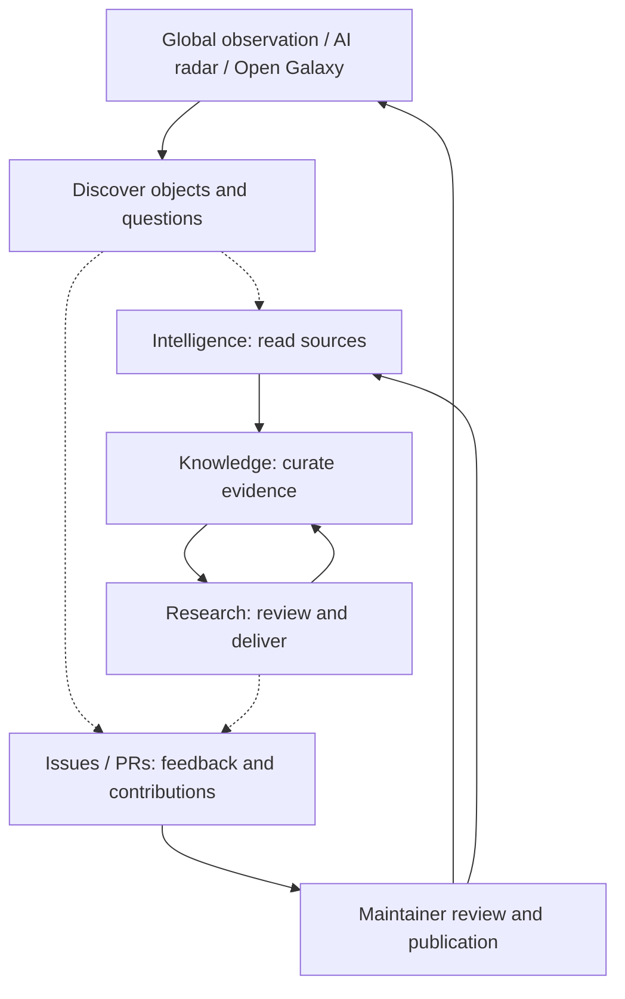

<!-- section:overview -->

# OpenDipper · 开源北斗

<picture>
  <source media="(prefers-color-scheme: dark)" srcset="public/brand/opendipper/opendipper-horizontal-dark.svg">
  
</picture>

**English** | [简体中文](README.zh-CN.md)

**OpenDipper turns AI and open-source ecosystem data into discoveries, organized knowledge and reviewable research reports.** Developers can find and compare projects; researchers and ecosystem teams can inspect evidence, organize a topic and prepare a decision. Global observation, AI radar and Open Galaxy help you discover what matters; the Agent Intelligence Room carries selected sources through reading, knowledge preparation and report delivery.

[Open the observatory](https://www.x-lab.info/open-dipper/) · [AI radar](https://www.x-lab.info/open-dipper/#radar) · [Open Galaxy](https://www.x-lab.info/open-dipper/#ecosystem) · [Agent Intelligence Room](https://www.x-lab.info/open-dipper/#briefing) · [Contribute](CONTRIBUTING.md) · [Roadmap](ROADMAP.md)

**First edition delivered (application 1.15.1):** [five-module milestone, verification and remaining boundaries](docs/releases/first-edition.md) · **[Watch the official film on Bilibili](https://www.bilibili.com/video/BV1J3xL63EPP/)** · [58-second five-module film, storyboard and reproduction](media/promo/README.md). The film uses global-observatory upstream totals to preview full-domain discovery; the current radar index remains a sourced preview sample.

<!-- section:first-exploration -->
## Try your first exploration

1. [Open the vLLM / SGLang case](https://www.x-lab.info/open-dipper/#briefing?tab=signals&case=inference) and read its six official sources.
2. Collect material into **Knowledge**, check the sources to include, then choose **Bring into research**.
3. Open the complete **editorial example**, inspect citations, edit the report and export Markdown or printable HTML; save the result back to your notebook.

This walkthrough needs no API key. It demonstrates evidence-to-report interaction, **not live DSH execution or a performance benchmark**. Work stays in this browser; export before clearing its storage. For relationship exploration, start with PyTorch in Open Galaxy: recorded shared-contributor links are not software dependencies or quality rankings.

**What did you discover, and where did you get stuck?** [Share your first exploration](https://github.com/X-lab2017/open-dipper/issues/35). If the tool helps your work, star the repository to find it again; feedback and source corrections are welcome too.

<!-- section:product -->
## What you can do

| Module | Useful outcome | Current scope |
| --- | --- | --- |
| Global observation | Explore participation, contribution, influence and ecosystem events on a map or globe | Six groups / eighteen layers, overlays, focused observation tabs, rankings and one/two-screen presentation |
| AI radar | Discover candidates by task, inspect sources, compare like entities and export a trial checklist | 160 sourced identities: 80 software, 60 models, 20 datasets; local following; optional **simulated** ring judgments |
| Open Galaxy | Find projects by task, shortlist candidates, trace recorded connections and export sourced research reports | 19,771 code repositories + 24,000 model/data/Space nodes; recorded and inferred links stay separate; [module contract](docs/OPEN_GALAXY.md) |
| Agent Intelligence Room | Read sources → organize a notebook → prepare research → review and deliver a report | Browser-local work; complete vLLM/SGLang editorial example; DSH adapter code prepared, runtime not connected |
| Community | Understand the mission, roadmap and how to contribute | Animated project introduction, [milestone timeline](https://www.x-lab.info/open-dipper/#contribute?view=milestones), source/rights disclosure and GitHub participation paths; [contract](docs/COMMUNITY_HUB.md) |

**Application: 1.17.0; visual system: 1.4.0; fixed map/radar baseline: 1.3.2.** The centered observatory opens Active developers and offers a five-stop World tour across companies, projects, models and events. [Implementation and validation](docs/plans/observatory-tour.md). [Current status and limits](docs/STATUS.md) · [Reusable baseline](design/baselines/README.md) · [Data scope](docs/DATA_EVIDENCE.md). Data has independent observation windows; synthetic activity is not live measurement. Public availability does not imply every model or dataset is open source.

### Global observation — find where to look

Start with a broad ecosystem question, combine geographic layers, then focus a region or entity to inspect rankings, metrics and sourced events. Keep the different observation periods and sample scopes visible rather than treating every layer as one global total.

<a href="https://www.x-lab.info/open-dipper/">
  <picture>
    <source media="(prefers-color-scheme: dark)" srcset="docs/assets/opendipper-1.6.0-atlas-dark-20261027.jpg">
    
  </picture>
</a>

*Production capture, 2026-10-27. The image follows your light/dark preference; capture date is not the data observation period. [Image provenance and compressed assets](docs/assets/README.md).*

### AI radar — choose what to try

Choose a task, explore relevant software, models or datasets, inspect source evidence, compare like candidates and export a trial checklist. Optional simulated ring judgments remain separate from source facts.

<a href="https://www.x-lab.info/open-dipper/#radar">
  <picture>
    <source media="(prefers-color-scheme: dark)" srcset="docs/assets/opendipper-1.6.0-radar-dark-20261027.jpg">
    
  </picture>
</a>

*Production capture, 2026-10-27. The image follows your light/dark preference; capture date is not the data observation period. [Image provenance and compressed assets](docs/assets/README.md).*

### Open Galaxy — understand connections and take away a report

Find a project by task or search, inspect its recorded neighborhood, shortlist up to three research objects, trace recorded paths and export a Markdown, HTML or JSON evidence report. Reports expose missing evidence and source dates; they are not live research, security audits or adoption recommendations.

<a href="https://www.x-lab.info/open-dipper/#ecosystem">
  <picture>
    <source media="(prefers-color-scheme: dark)" srcset="docs/assets/opendipper-1.6.0-galaxy-dark-20261027.jpg">
    
  </picture>
</a>

*Production capture, 2026-10-27. The image follows your light/dark preference; capture date is not the data observation period. [Image provenance and compressed assets](docs/assets/README.md).*

### Agent Intelligence Room — from sources to a deliverable

**Intelligence / Knowledge / Research** separates reading from knowledge preparation and execution. The Folo-inspired reader keeps navigation, list and reading in three columns. The Open Notebook-inspired workspace holds source selections and editable notes. Research adds a scoped question, evidence panel, report editing and delivery.


*Reader and notebook captures from earlier iterations, not a screenshot of the new Research surface. The current walkthrough and limits are documented in the [workflow guide](docs/INTELLIGENCE_WORKFLOW.md).*

The source catalog is a bounded sample, not full-web coverage. Folo and Open Notebook are interaction references, not embedded services. DSH is the selected execution direction; [server adapter setup](services/research/README.md) still requires a provisioned runtime, matching SDK, model and authenticated gateway. Without them, Run is disabled and the example is a separate action. There is no cloud sync, autonomous monitoring or notification delivery.

<!-- section:participation -->
## Start with your question or contribution

No coding knowledge is needed to suggest a better outcome. Issues welcome English and Chinese.

| I want to… | Start here |
| --- | --- |
| Explain a need or propose a capability | [Feature request](https://github.com/X-lab2017/open-dipper/issues/new?template=feature_request.yml) — who needs it, the situation and the desired result |
| Report broken behavior | [Bug report](https://github.com/X-lab2017/open-dipper/issues/new?template=bug_report.yml) — steps, actual result and expected result |
| Correct a number, entity, location or attribution | [Data correction](https://github.com/X-lab2017/open-dipper/issues/new?template=data_correction.yml) — affected item and source evidence |
| Review readability or an interaction | [Experience feedback](https://github.com/X-lab2017/open-dipper/issues/new?template=experience_feedback.yml) — a concrete task and what helped or got in the way |
| Contribute a sourced news item | [Event submission](https://github.com/X-lab2017/open-dipper/issues/new?template=ecosystem-event.yml) — independent editorial approval follows |
| Make a first contribution | [Contribution guide](CONTRIBUTING.md) — source directory, terminology and content tasks |

Search existing issues before opening one; add evidence to an existing discussion when it fits. Feedback, documentation, translation, source verification and code are all useful contributions.

<!-- section:collaboration -->
## Human direction, agent-led engineering

People bring needs, domain knowledge and product review. Agents are the primary engineering collaborators: they inspect versioned context, implement scoped changes, verify results and leave a reproducible handoff. Human code contributions are equally welcome.

**Need → scoped issue → implementation → evidence → outcome review.** Maintainers govern direction and releases; an issue does not automatically launch an agent. The [Harness workflow](docs/HARNESS.md) separates existing checks from future automation.

- **People:** [CONTRIBUTING.md](CONTRIBUTING.md) → a live issue → an agreed small contribution.
- **Agents:** [AGENTS.md](AGENTS.md) → [current status](docs/STATUS.md) → [task-specific context](docs/CONTEXT.json).
- **Reviewers:** [review walkthrough](docs/REVIEW.md) → reproducible evidence → feedback in the issue/PR.

<!-- section:business -->
## Product view



Dashed arrows are user actions, not automatic cross-module context transfer or public sharing. The **[Community](https://www.x-lab.info/open-dipper/#contribute)** page introduces the mission, four-module concept animation, roadmap and ways to contribute through GitHub. See the [implementation contract](docs/COMMUNITY_HUB.md). No automatic posting or private notebook sharing.

<!-- section:development -->
## Run locally

Node.js 24, npm and Python 3. Bundled snapshots support development without credentials or upstream data collection after dependencies are installed.

```sh
npm ci
npm run dev
```

```sh
npm run typecheck
npm test
npm run build
```

Documentation-only edits: `npm run docs:build` then `npm run docs:check`. [Development guide](docs/DEVELOPMENT.md) covers task-specific checks, browser reproduction and generated files. Source and deployment snapshots keep their own dates.

<!-- section:architecture -->
## Technical view


PRs validate changes; eligible main workflows collect, archive and deploy snapshots. There is no public write API or client credential. See [architecture](docs/ARCHITECTURE.md) and [operations](docs/OPERATIONS.md).

<!-- section:documentation -->
## Find the right context

| Need | Document |
| --- | --- |
| Current capabilities and gaps | [Status](docs/STATUS.md) · [Roadmap](ROADMAP.md) |
| Reuse the accepted design | [Baseline index](design/baselines/README.md) · [Module template](docs/templates/OBSERVATORY_MODULE.md) · [Brand assets](public/brand/opendipper/README.md) |
| Understand decisions and previous iterations | [History](docs/HISTORY.md) · [Decisions](docs/DECISIONS.md) |
| Navigate engineering knowledge | [Documentation map](docs/README.md) · [Machine task index](docs/CONTEXT.json) |

<!-- section:transparency -->
## Transparency and reuse

AI agents contributed implementation, visual iterations and repository maintenance. Contributions disclose the work performed, actual verification and remaining uncertainty; private prompts and chats are not required. Observed facts, unknown values and fixed demonstrations remain distinct.

OpenDipper is independently implemented. Spatial interaction references [world-monitor.com](https://world-monitor.com/); engineering references include the separate [koala73/worldmonitor](https://github.com/koala73/worldmonitor) project. Source and brand notices remain in the repository.

**License decision remains open:** a root application LICENSE has not been selected. Application code, datasets, maps and brand assets have separate rights; public visibility is not a blanket license. See [rights](docs/RIGHTS.md) and [decision #6](https://github.com/X-lab2017/open-dipper/issues/6). For sensitive reports, follow [SECURITY.md](SECURITY.md).

Conferences & events now includes 392 CCF-labelled Conference Partner records plus 2 community events, with schedule filters and city-reference mapping. Ranks are third-party metadata; unlocated records remain searchable. See the [data and refresh contract](docs/CONFERENCES.md).
