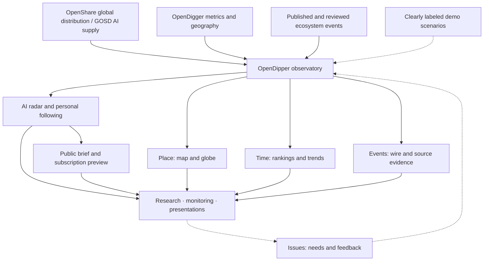
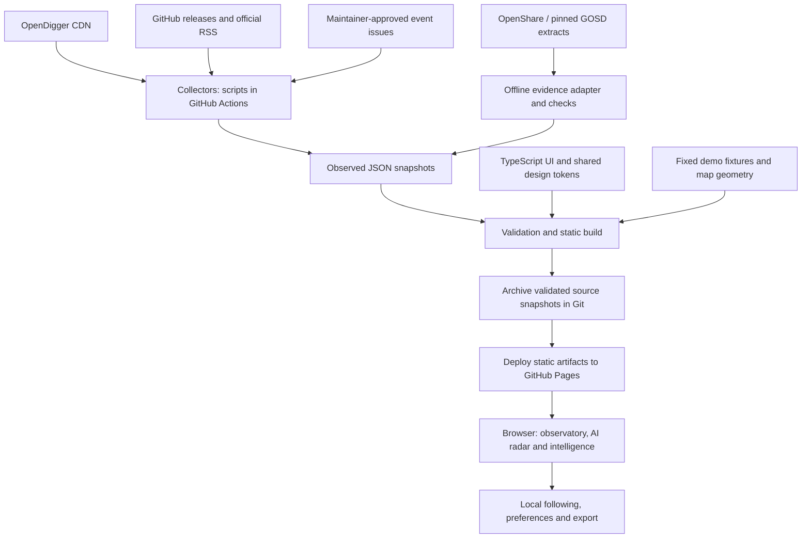

<!-- section:overview -->
# OpenDipper · 开源北斗

<picture>
  <source media="(prefers-color-scheme: dark)" srcset="public/brand/opendipper/opendipper-horizontal-dark.svg">
  
</picture>


**English** | [简体中文](README.zh-CN.md)

**A global AI and open-source intelligence observatory for researchers and developers.** Explore sourced events, AI research signals and OpenDigger metrics through a map, globe, news wire and personal intelligence workspace.

[Open the observatory](https://www.x-lab.info/open-dipper/) · [Roadmap](ROADMAP.md) · [Request a feature](https://github.com/X-lab2017/open-dipper/issues/new?template=feature_request.yml) · [Report a problem](https://github.com/X-lab2017/open-dipper/issues/new?template=bug_report.yml) · [Visual baseline](https://www.x-lab.info/open-dipper/design-system.html)

[](https://www.x-lab.info/open-dipper/)

*2026-10-25 · Published observed-data view; source dates and demo events are labelled independently. A version record, not live statistics. [Data scope](docs/DATA_EVIDENCE.md) · [Visual evolution](docs/archive/2026-10-25-visual-evolution.md).*

[Reusable brand assets](public/brand/opendipper/README.md) · [Approved design references](docs/assets/brand-reference/README.md)

The current atlas combines six groups and eighteen layers: regional fills, proportional asset bubbles and circular entities. Tabbed observations, top-ten rankings and paired themes support one- or two-screen presentations. See the [workspace contract](docs/ATLAS_WORKSPACE.md). Synthetic pulse growth remains separate from sourced news and report snapshots.

<!-- section:business -->
## Business view



Observed data and demonstration scenarios remain separate throughout the product. Users explore the evidence and feed new needs back through issues.

<!-- section:collaboration -->
## Human direction, agent-led engineering

We build OpenDipper around **human needs, agent execution and verifiable outcomes**. People shape the product through issues and review the results. Agents are the primary engineering collaborators, working from versioned context to implement, test, document and refine changes. Human code contributions remain welcome.

| Participant | Main responsibility | Starting point |
| --- | --- | --- |
| Users and domain experts | Describe the scenario, desired outcome and what would make the result useful | [Submit a need](https://github.com/X-lab2017/open-dipper/issues/new?template=feature_request.yml) |
| Maintainers | Set priorities and scope, resolve product/data decisions, accept outcomes and govern releases | [Issues](https://github.com/X-lab2017/open-dipper/issues) and [contribution guide](CONTRIBUTING.md) |
| Engineering agents | Inspect context, plan, implement, verify, self-review and leave an evidence-backed handoff | [AGENTS.md](AGENTS.md) and [engineering workflow](docs/HARNESS.md) |

<!-- section:needs -->
## Have a need? Start with an issue

You do not need to know the code or design a technical solution. Tell us:

1. **Your situation:** who is using OpenDipper, and for what task?
2. **Your desired result:** what should become possible or easier?
3. **How you would judge it:** a useful example, observable result or screenshot, if available.

For example: “When presenting on a conference screen, I want the map and news wire to remain readable without scrolling; I can review the result at 1920×1080.” Maintainers and agents turn this into a scoped task and testable acceptance criteria.

Use the [bug form](https://github.com/X-lab2017/open-dipper/issues/new?template=bug_report.yml) for broken behavior. To contribute a sourced ecosystem publication, use the separate [event form](https://github.com/X-lab2017/open-dipper/issues/new?template=ecosystem-event.yml); editorial approval remains a separate process. Issues may be written in English or Chinese.

<!-- section:execution -->
## Agent engineering workflow

1. **Clarify the task:** link the issue, record the outcome, scope and acceptance criteria. Extend the existing issue; use an [engineering task](https://github.com/X-lab2017/open-dipper/issues/new?template=agent_task.yml) only when a separate implementation unit helps.
2. **Load the right context:** start at [AGENTS.md](AGENTS.md), then follow the [task index](docs/CONTEXT.json). For complex or multi-session work, keep a versioned [execution plan](docs/plans/README.md).
3. **Implement and check:** work within the agreed scope; reproduce failures, run relevant checks, inspect the result and fix failures before handoff.
4. **Deliver evidence:** submit a focused PR with acceptance results, actual test output, visual evidence where relevant, documentation updates and AI-work disclosure.
5. **Close the loop:** the maintainer reviews outcomes and release readiness. Record the result in the issue and preserve reusable lessons in contracts, tests or docs.

The full lifecycle and completion criteria are in [HARNESS.md](docs/HARNESS.md). Existing authorization determines which actions an agent may perform.

<!-- section:harness -->
## What the harness provides

Here, the *harness* is the context, tools, constraints and feedback that make engineering work repeatable.

| Layer | Repository mechanism |
| --- | --- |
| Context | Short [Agent entry](AGENTS.md), [architecture](docs/ARCHITECTURE.md), [decisions](docs/DECISIONS.md), task-specific reading paths |
| Constraints | [Data contracts](docs/DATA_CONTRACTS.md), [visual baseline](docs/VISUAL_SYSTEM.md), source provenance and generated-file ownership |
| Execution | Local development, reproducible commands, [plans](docs/plans/README.md) and [handoffs](docs/templates/HANDOFF.md) |
| Verification | Type checks, contract/behavior tests, visual resource checks, documentation checks and Chromium acceptance in [CI](.github/workflows/pages.yml) |
| Feedback | Issue → implementation → evidence → outcome review → updated repository knowledge |

**Current automation:** CI validates changes and publishes eligible main-branch builds. Authorized collaborators currently start agent work; opening an issue does not automatically launch an agent. An always-on issue dispatcher, automatic assignment and autonomous merge are not configured. See [the capability and evidence table](docs/HARNESS.md).

<!-- section:product -->
## Explore the observatory

- **Map / Globe / Wire:** geographic layers, located events, filters and source inspection. The map opens by default; the globe adds atmospheric lighting and inertial interaction.
- **AI radar:** monthly model/dataset additions, four topics, search, evidence details and linked map locations; collected items and fixed fictional examples stay visibly separate.
- **Personal intelligence:** local topic following, saved signals, repository links, a readable public sample and Markdown export. Pro benefits are proposals; no payment, email delivery or cloud account is active.
- **Community:** concrete source, evidence, research and service tasks with public GitHub entry points.
- **Monthly analysis:** same-platform rankings, twelve-month trends, playback and local watchlists.
- **Presentation:** one-screen overview, two-screen AI and intelligence discovery, fullscreen, responsive layout, English/Chinese and dark/light themes.
- **Reusable visual system:** X-lab official assets, shared CSS/Canvas tokens and a [downloadable baseline](https://www.x-lab.info/open-dipper/design-system.html).

| Data channel | Current scope | Cadence |
| --- | --- | --- |
| OpenShare global distribution | Developer stock, developer OpenRank contribution, project OpenRank influence | Global annual total and regional periods labelled separately |
| GOSD / OpenGauge AI supply | HF model/dataset totals and monthly additions chart | Pinned report snapshot |
| OpenDigger repository metrics | 20 curated repositories, 4 platforms, 6 metrics | Monthly |
| Geographic aggregates | Microsoft, Apache and PyTorch Foundation labels; independent trailing-year periods | Retrieved monthly |
| Ecosystem events | Selected GitHub releases, OpenSSF/CNCF RSS and approved editorial issues | Collection target: 30 minutes |
| Demonstration | 13 fictional ecosystem events, 8 AI intelligence scenarios and synthetic geographic metrics | Fixed fixtures, visibly identified |

**OpenDigger organization/repository data remains sampled**; explicit OpenShare global totals and GOSD platform totals have separate scopes and cannot be added together. [Sources, dates and refresh rules](docs/DATA_EVIDENCE.md). Missing values stay missing; unknown locations stay unlocated. Annual geographic aggregates do not move with the repository month slider. The browser checks deployed event snapshots every five minutes; collection targets are not a real-time SLA. Definitions and limitations: [data contracts](docs/DATA_CONTRACTS.md).

<!-- section:architecture -->
## Technical architecture



This is the publication path on main. PRs validate without collecting, archiving data or deploying; scheduled builds skip browser acceptance. The browser loads published snapshots and has no write API or publishing token. Module responsibilities and failure behavior: [architecture](docs/ARCHITECTURE.md) and [operations](docs/OPERATIONS.md).

<!-- section:development -->
## Run locally

Use Node.js 24, npm and Python 3. After dependency installation, bundled snapshots support local development without upstream collection.

```sh
npm ci
npm run dev
npm run typecheck
npm test
npm run build
```

Task-specific checks and browser setup: [development guide](docs/DEVELOPMENT.md). Scheduled collection, manual event review, failure recovery and deployment: [operations](docs/OPERATIONS.md). Detailed analysis and the previous panorama remain tested compatibility routes.

<!-- section:documentation -->
## Documentation and roadmap

| Question | Read |
| --- | --- |
| How does the intelligence framework work? | [Product, data and service boundaries](docs/INTELLIGENCE.md) · [Delivery #14](https://github.com/X-lab2017/open-dipper/issues/14) · [First content task #19](https://github.com/X-lab2017/open-dipper/issues/19) |
| What is available, verified or still missing? | [Current status and issue index](docs/STATUS.md) |
| How do I contribute or hand work to an agent? | [Contributing](CONTRIBUTING.md) · [Harness workflow](docs/HARNESS.md) |
| Where is the knowledge base? | [Documentation map](docs/README.md) · [Machine context](docs/CONTEXT.json) |
| Why did the product evolve this way? | [History](docs/HISTORY.md) · [Decisions](docs/DECISIONS.md) · [Changelog](CHANGELOG.md) |
| How do I reuse the visual system? | [Visual specification](docs/VISUAL_SYSTEM.md) · [Design resources](design/README.md) |
| What comes next? | [Phased roadmap](ROADMAP.md) · [Coordination #8](https://github.com/X-lab2017/open-dipper/issues/8) · [Full-coverage data #4](https://github.com/X-lab2017/open-dipper/issues/4) · [Event quality #5](https://github.com/X-lab2017/open-dipper/issues/5) · [License decision #6](https://github.com/X-lab2017/open-dipper/issues/6) |
| Where can I make a first contribution? | [Source directory #12](https://github.com/X-lab2017/open-dipper/issues/12) · [Bilingual terminology #13](https://github.com/X-lab2017/open-dipper/issues/13) — check the live issue state before starting |

README and contribution guides have English and Chinese editions. Deeper references currently use their maintained source language. Update both entry editions together; structural checks detect section/link drift, while contributors review translation meaning. Discovery endpoints: [llms.txt](https://www.x-lab.info/open-dipper/llms.txt) and [agent-context.json](https://www.x-lab.info/open-dipper/agent-context.json).

<!-- section:transparency -->
## Transparency and reuse

AI agents participated in the October 2026 implementation, visual iterations and documentation. Contributions disclose agent/tool involvement, verification and remaining uncertainty; there is no claim that every line is agent-written or independently human-reviewed. Our operating model adapts [Harness engineering](https://openai.com/index/harness-engineering/) to this repository; [HARNESS.md](docs/HARNESS.md) distinguishes enforced checks from process conventions and future capabilities.

OpenDipper is independently implemented. Spatial inspiration comes from [world-monitor.com](https://world-monitor.com/); engineering references include the separate [koala73/worldmonitor](https://github.com/koala73/worldmonitor) project. X-lab assets retain their [official provenance](public/brand/provenance.json), and dependencies retain [third-party notices](public/THIRD_PARTY_NOTICES.txt).

**License status:** an application-level LICENSE has not yet been selected. Application code, source data, map geometry and brand assets have distinct rights; public availability does not grant a blanket reuse license. See [rights status](docs/RIGHTS.md) and [decision #6](https://github.com/X-lab2017/open-dipper/issues/6).

Audience presets and entity layers: see the [observation workspace contract](docs/OBSERVATION_WORKSPACE.md) for the eight coverage categories, data scope and pending facility sources.
