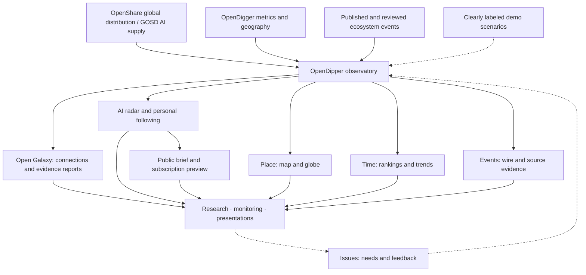

<!-- section:overview -->
# OpenDipper · 开源北斗

<picture>
  <source media="(prefers-color-scheme: dark)" srcset="public/brand/opendipper/opendipper-horizontal-dark.svg">
  
</picture>

**English** | [简体中文](README.zh-CN.md)

**Explore the global AI and open-source ecosystem. Find relevant projects, inspect evidence and decide what to try next.** OpenDipper connects geographic observation, a task-oriented AI radar and an explorable open-source galaxy for developers, researchers and ecosystem communities.

[Open the observatory](https://www.x-lab.info/open-dipper/) · [AI radar](https://www.x-lab.info/open-dipper/#radar) · [Open Galaxy](https://www.x-lab.info/open-dipper/#ecosystem) · [Contribute](CONTRIBUTING.md) · [Roadmap](ROADMAP.md)

<!-- section:product -->
## What you can do

| Module | Useful outcome | Current scope |
| --- | --- | --- |
| Global observation | Explore participation, contribution, influence and ecosystem events on a map or globe | Six groups / eighteen layers, overlays, focused observation tabs, rankings and one/two-screen presentation |
| AI radar | Discover candidates by task, inspect sources, compare like entities and export a trial checklist | 160 sourced identities: 80 software, 60 models, 20 datasets; local following; optional **simulated** ring judgments |
| Open Galaxy · 1.5.1 | Find projects by task, shortlist candidates, trace recorded connections and export sourced research reports | 19,771 code repositories + 24,000 model/data/Space nodes; recorded and inferred links stay separate; [module contract](docs/OPEN_GALAXY.md) |
| Intelligence | Read public brief examples and save interests | Browser-local preferences; subscription delivery and paid services remain planned |

**Accepted product baseline: application 1.3.2.** [Current status and limits](docs/STATUS.md) · [Reusable baseline](design/baselines/README.md) · [Data scope](docs/DATA_EVIDENCE.md). Data has independent observation windows; synthetic activity is not live measurement. Public availability does not imply every model or dataset is open source.

### Global observation — find where to look

Start with a broad ecosystem question, combine geographic layers, then focus a region or entity to inspect rankings, metrics and sourced events. Keep the different observation periods and sample scopes visible rather than treating every layer as one global total.

[](https://www.x-lab.info/open-dipper/)

*Global observation implementation preview, 2026-10-25; this retained historical capture is not a current-data claim. [Map/globe behavior and current layer contract](docs/ATLAS_WORKSPACE.md).*

### AI radar — choose what to try

Choose a task, explore relevant software, models or datasets, inspect source evidence, compare like candidates and export a trial checklist. Optional simulated ring judgments remain separate from source facts.

[](https://www.x-lab.info/open-dipper/#radar)

*AI radar 1.3.2 implementation preview, 2026-10-26. [Dark/light review and behavior](docs/AI_RADAR.md).*

### Open Galaxy — understand connections and take away a report

Find a project by task or search, inspect its recorded neighborhood, shortlist up to three research objects, trace recorded paths and export a Markdown, HTML or JSON evidence report. Reports expose missing evidence and source dates; they are not live research, security audits or adoption recommendations.

[](https://www.x-lab.info/open-dipper/#ecosystem)

*Open Galaxy 1.5.1 light-theme CI acceptance capture, 2026-10-26: recorded PyTorch–vLLM path and research shortlist. Browser checks include dark/light, mobile and actual Markdown/HTML/JSON downloads. This is a CI capture, not a production screenshot. [Research and relationship contract](docs/OPEN_GALAXY.md) · [Public-release validation record](docs/plans/ecosystem-public-release.md).*

<!-- section:participation -->
## Start with your question or contribution

No coding knowledge is needed to suggest a better outcome. Issues welcome English and Chinese.

| I want to… | Start here |
| --- | --- |
| Explain a need or propose a capability | [Feature request](https://github.com/X-lab2017/open-dipper/issues/new?template=feature_request.yml) — who needs it, the situation and the desired result |
| Report broken behavior | [Bug report](https://github.com/X-lab2017/open-dipper/issues/new?template=bug_report.yml) — steps, actual result and expected result |
| Correct a number, entity, location or attribution | [Data correction](https://github.com/X-lab2017/open-dipper/issues/new?template=data_correction.yml) — affected item and source evidence |
| Review readability or an interaction | [Experience feedback](https://github.com/X-lab2017/open-dipper/issues/new?template=experience_feedback.yml) — a concrete task and what helped or got in the way |
| Contribute a sourced news item | [Event submission](https://github.com/X-lab2017/open-dipper/issues/new?template=ecosystem-event.yml) — independent editorial approval follows |
| Make a first contribution | [Contribution guide](CONTRIBUTING.md) — source directory, terminology and content tasks |

Search existing issues before opening one; add evidence to an existing discussion when it fits. Feedback, documentation, translation, source verification and code are all useful contributions.

<!-- section:collaboration -->
## Human direction, agent-led engineering

People bring needs, domain knowledge and product review. Agents are the primary engineering collaborators: they inspect versioned context, implement scoped changes, verify results and leave a reproducible handoff. Human code contributions are equally welcome.

**Need → scoped issue → implementation → evidence → outcome review.** Maintainers govern direction and releases; an issue does not automatically launch an agent. The [Harness workflow](docs/HARNESS.md) separates existing checks from future automation.

- **People:** [CONTRIBUTING.md](CONTRIBUTING.md) → a live issue → an agreed small contribution.
- **Agents:** [AGENTS.md](AGENTS.md) → [current status](docs/STATUS.md) → [task-specific context](docs/CONTEXT.json).
- **Reviewers:** [review walkthrough](docs/REVIEW.md) → reproducible evidence → feedback in the issue/PR.

<!-- section:business -->
## Product view



<!-- section:development -->
## Run locally

Node.js 24, npm and Python 3. Bundled snapshots support development without credentials or upstream data collection after dependencies are installed.

```sh
npm ci
npm run dev
```

```sh
npm run typecheck
npm test
npm run build
```

Documentation-only edits: `npm run docs:build` then `npm run docs:check`. [Development guide](docs/DEVELOPMENT.md) covers task-specific checks, browser reproduction and generated files. Source and deployment snapshots keep their own dates.

<!-- section:architecture -->
## Technical view


PRs validate changes; eligible main workflows collect, archive and deploy snapshots. There is no public write API or client credential. See [architecture](docs/ARCHITECTURE.md) and [operations](docs/OPERATIONS.md).

<!-- section:documentation -->
## Find the right context

| Need | Document |
| --- | --- |
| Current capabilities and gaps | [Status](docs/STATUS.md) · [Roadmap](ROADMAP.md) |
| Reuse the accepted design | [Baseline index](design/baselines/README.md) · [Module template](docs/templates/OBSERVATORY_MODULE.md) · [Brand assets](public/brand/opendipper/README.md) |
| Understand decisions and previous iterations | [History](docs/HISTORY.md) · [Decisions](docs/DECISIONS.md) |
| Navigate engineering knowledge | [Documentation map](docs/README.md) · [Machine task index](docs/CONTEXT.json) |

<!-- section:transparency -->
## Transparency and reuse

AI agents contributed implementation, visual iterations and repository maintenance. Contributions disclose the work performed, actual verification and remaining uncertainty; private prompts and chats are not required. Observed facts, unknown values and fixed demonstrations remain distinct.

OpenDipper is independently implemented. Spatial interaction references [world-monitor.com](https://world-monitor.com/); engineering references include the separate [koala73/worldmonitor](https://github.com/koala73/worldmonitor) project. Source and brand notices remain in the repository.

**License decision remains open:** a root application LICENSE has not been selected. Application code, datasets, maps and brand assets have separate rights; public visibility is not a blanket license. See [rights](docs/RIGHTS.md) and [decision #6](https://github.com/X-lab2017/open-dipper/issues/6). For sensitive reports, follow [SECURITY.md](SECURITY.md).
