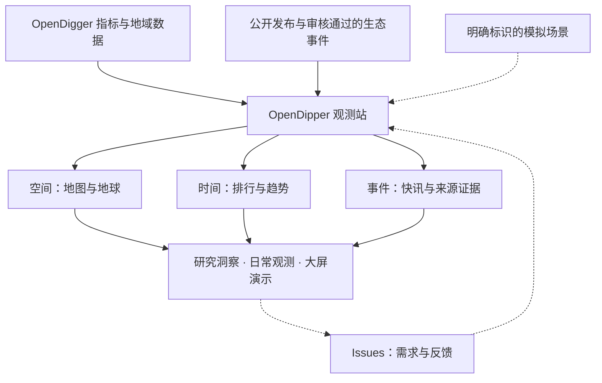
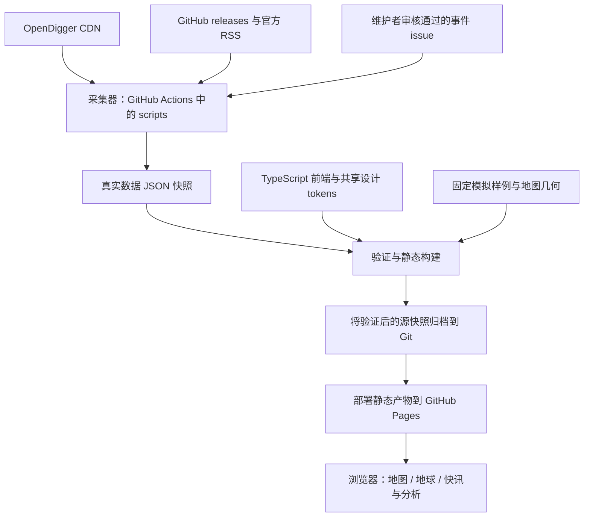

<!-- section:overview -->
# OpenDipper

[English](README.md) | **简体中文**

**全球开源生态观测站。** 通过地图、地球与快讯，探索 OpenDigger 月度指标和半实时开源生态事件。

[进入观测站](https://www.x-lab.info/open-dipper/) · [提出需求](https://github.com/X-lab2017/open-dipper/issues/new?template=feature_request.yml) · [反馈问题](https://github.com/X-lab2017/open-dipper/issues/new?template=bug_report.yml) · [查看视觉基线](https://www.x-lab.info/open-dipper/design-system.html)

[](https://www.x-lab.info/open-dipper/)

*界面快照 · 2026-10-25 · 中文界面。数值与模拟标识保留截图当时的状态，不代表实时统计。[查看视觉演进](docs/archive/2026-10-25-visual-evolution.md)。*

<!-- section:business -->
## 业务视角



真实观测和模拟场景始终分开。用户探索证据，并通过 issue 将新的需求带回产品迭代。

<!-- section:collaboration -->
## 人提出方向，Agent 推进工程

OpenDipper 围绕**人的需求、Agent 的执行与可验证的结果**开展协作。大家通过 issue 影响产品、评审结果；Agent 作为主要工程协作者，依据版本化上下文完成实现、测试、文档与修正。我们同样欢迎人类开发者贡献代码。

| 参与者 | 主要职责 | 从这里开始 |
| --- | --- | --- |
| 用户与领域专家 | 描述使用场景、期望结果，以及怎样才算有用 | [提交需求](https://github.com/X-lab2017/open-dipper/issues/new?template=feature_request.yml) |
| 维护者 | 决定优先级和范围，处理产品/数据取舍，验收结果并管理发布 | [Issues](https://github.com/X-lab2017/open-dipper/issues) 与 [贡献指南](CONTRIBUTING.zh-CN.md) |
| 工程 Agent | 读取上下文、制定计划、实现、验证、自检，留下有证据的交接 | [AGENTS.md](AGENTS.md) 与 [工程工作流](docs/HARNESS.md) |

<!-- section:needs -->
## 有需求？从一个 issue 开始

你无需了解代码，也无需先设计技术方案。只需告诉我们：

1. **使用场景**：谁在使用 OpenDipper，要完成什么任务？
2. **期望结果**：希望什么事情变得可行或更容易？
3. **判断方法**：如果方便，提供一个例子、可观察的效果或截图。

例如：“在大会大屏演示时，我希望地图和快讯无需滚动就能看清，可以在 1920×1080 屏幕上评审效果。”维护者与 Agent 会将其转为有明确范围和验收条件的工程任务。

功能异常使用 [问题表单](https://github.com/X-lab2017/open-dipper/issues/new?template=bug_report.yml)。提交有来源的生态资讯，请使用独立的 [事件表单](https://github.com/X-lab2017/open-dipper/issues/new?template=ecosystem-event.yml)，事件审核仍是单独流程。Issue 可以使用中文或英文。

<!-- section:execution -->
## Agent 如何完成工程工作

1. **明确任务**：关联 issue，记录目标、范围与验收条件。优先补全现有 issue；只有确实需要独立实现单元时，才拆分 [工程任务](https://github.com/X-lab2017/open-dipper/issues/new?template=agent_task.yml)。
2. **读取上下文**：从 [AGENTS.md](AGENTS.md) 进入，按 [任务索引](docs/CONTEXT.json) 逐步读取；复杂或跨会话工作保留版本化的 [执行计划](docs/plans/README.md)。
3. **实现与验证**：在约定范围内工作，复现问题、运行相关检查、检查结果，并在交接前修复失败。
4. **提交证据**：通过聚焦的 PR 提供验收结果、实际测试、必要的视觉证据、文档更新与 AI 工作披露。
5. **闭环改进**：维护者评审结果和发布条件，issue 记录最终交付，可复用经验进入契约、测试或文档。

完整生命周期与完成条件见 [HARNESS.md](docs/HARNESS.md)。Agent 可以执行哪些操作，由任务中已有的授权决定。

<!-- section:harness -->
## 工程 Harness 提供什么

这里的 Harness，是让工程工作可重复执行的一套上下文、工具、约束和反馈机制。

| 层次 | 仓库中的机制 |
| --- | --- |
| 上下文 | 简短的 [Agent 入口](AGENTS.md)、[架构](docs/ARCHITECTURE.md)、[决策](docs/DECISIONS.md) 与按任务读取的路径 |
| 约束 | [数据契约](docs/DATA_CONTRACTS.md)、[视觉基线](docs/VISUAL_SYSTEM.md)、来源溯源与生成文件归属 |
| 执行 | 本地开发、可复现命令、[执行计划](docs/plans/README.md) 和 [交接记录](docs/templates/HANDOFF.md) |
| 验证 | [CI](.github/workflows/pages.yml) 中的类型检查、契约/行为测试、视觉资源检查、文档检查与 Chromium 验收 |
| 反馈 | 需求 issue → 工程实现 → 验证证据 → 结果评审 → 仓库知识更新 |

**目前的自动化程度：** CI 自动检查变更并发布符合条件的 main 构建；Agent 由已获授权的协作者启动，创建 issue 暂不会自动启动 Agent。常驻任务调度、自动认领和自主合并尚未配置，具体见 [能力与证据表](docs/HARNESS.md)。

<!-- section:product -->
## 探索观测站

- **地图 / 地球 / 快讯**：地域图层、可定位事件、筛选和来源查看。默认进入地图，地球提供大气光照与惯性交互。
- **月度分析**：同平台排行、十二个月趋势、月份回放与本地关注列表。
- **演示场景**：一屏总览、两屏分析、全屏、响应式排版、中英文和深浅主题。
- **可复用视觉体系**：X-lab 官方素材、共享 CSS/Canvas tokens 和 [可下载视觉基线](https://www.x-lab.info/open-dipper/design-system.html)。

| 数据通道 | 当前范围 | 更新节奏 |
| --- | --- | --- |
| OpenDigger 仓库指标 | 20 个精选仓库、4 个平台、6 类指标 | 月度 |
| 地域聚合 | Microsoft、Apache 和 PyTorch Foundation 标签，各自独立的近一年周期 | 每月获取 |
| 生态事件 | 部分 GitHub releases、OpenSSF/CNCF RSS 与审核通过的编辑 issue | 目标每 30 分钟采集 |
| 演示数据 | 13 个虚构定位事件与模拟地域指标 | 固定样例，明确标识 |

这些是**样本，不是全球总体统计**。缺失值不补零，未知位置不虚构；年度地域聚合不随仓库月度轴变化。浏览器每五分钟检查已部署事件快照，采集目标不代表严格实时保障。定义与限制见 [数据契约](docs/DATA_CONTRACTS.md)。

<!-- section:architecture -->
## 技术架构



图中展示 main 的发布路径。PR 仅验证，不采集、不归档数据、不部署；定时构建跳过浏览器验收。浏览器读取已发布快照，不包含写入 API 或发布凭据。模块职责与失败行为见 [架构](docs/ARCHITECTURE.md) 和 [运维](docs/OPERATIONS.md)。

<!-- section:development -->
## 本地运行

使用 Node.js 24、npm 和 Python 3。安装依赖后，可使用仓库已有快照开发，无需重新采集上游数据。

```sh
npm ci
npm run dev
npm run typecheck
npm test
npm run build
```

任务对应的检查与浏览器环境见 [开发指南](docs/DEVELOPMENT.md)；定时采集、人工事件审核、故障恢复和部署见 [运维指南](docs/OPERATIONS.md)。详细分析页与旧全景页仍作为兼容入口保留并接受测试。

<!-- section:documentation -->
## 文档与后续方向

| 你想了解什么 | 阅读入口 |
| --- | --- |
| 目前做到了什么、验证了什么、还缺什么？ | [当前状态与 issue 索引](docs/STATUS.md) |
| 如何参与，或把工作交给 Agent？ | [贡献指南](CONTRIBUTING.zh-CN.md) · [Harness 工作流](docs/HARNESS.md) |
| 知识库在哪里？ | [文档导航](docs/README.md) · [机器上下文](docs/CONTEXT.json) |
| 产品为什么演进成现在这样？ | [协作历史](docs/HISTORY.md) · [决策记录](docs/DECISIONS.md) · [变更记录](CHANGELOG.md) |
| 如何复用视觉体系？ | [视觉规范](docs/VISUAL_SYSTEM.md) · [设计资源](design/README.md) |
| 下一阶段做什么？ | [全域数据 #4](https://github.com/X-lab2017/open-dipper/issues/4) · [事件质量 #5](https://github.com/X-lab2017/open-dipper/issues/5) · [许可决策 #6](https://github.com/X-lab2017/open-dipper/issues/6) |

README 与贡献指南提供中英文版本，深入参考文档暂保留各自维护语言。入口两种语言在同一变更中更新；自动检查检测章节与链接差异，翻译含义由贡献者复核。机器发现入口：[llms.txt](https://www.x-lab.info/open-dipper/llms.txt) 与 [agent-context.json](https://www.x-lab.info/open-dipper/agent-context.json)。

<!-- section:transparency -->
## 信息披露与复用

AI Agent 参与了 2026 年 10 月的实现、视觉迭代和文档整理。贡献需披露工具/Agent 参与范围、验证结果与尚不确定的内容；我们没有声称全部代码由 Agent 编写，也没有声称所有内容均经独立人工审核。本项目参考 [Harness engineering](https://openai.com/index/harness-engineering/) 并结合仓库现状制定工作方式，[HARNESS.md](docs/HARNESS.md) 区分已自动检查的约束、协作约定与未来能力。

OpenDipper 独立实现。空间体验参考 [world-monitor.com](https://world-monitor.com/)，工程参考包括另一个独立项目 [koala73/worldmonitor](https://github.com/koala73/worldmonitor)。X-lab 素材保留 [官方来源](public/brand/provenance.json)，依赖保留 [第三方声明](public/THIRD_PARTY_NOTICES.txt)。

**许可状态：** 应用代码尚未选定根 LICENSE。应用源码、源数据、地图几何和品牌素材的权利不同，公开可见不等于统一授权。详见 [权利说明](docs/RIGHTS.md) 与 [决策 #6](https://github.com/X-lab2017/open-dipper/issues/6)。
