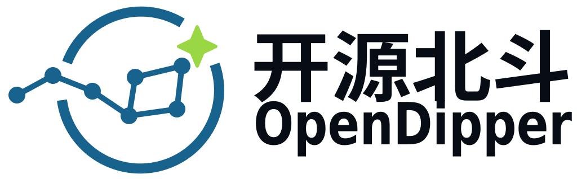
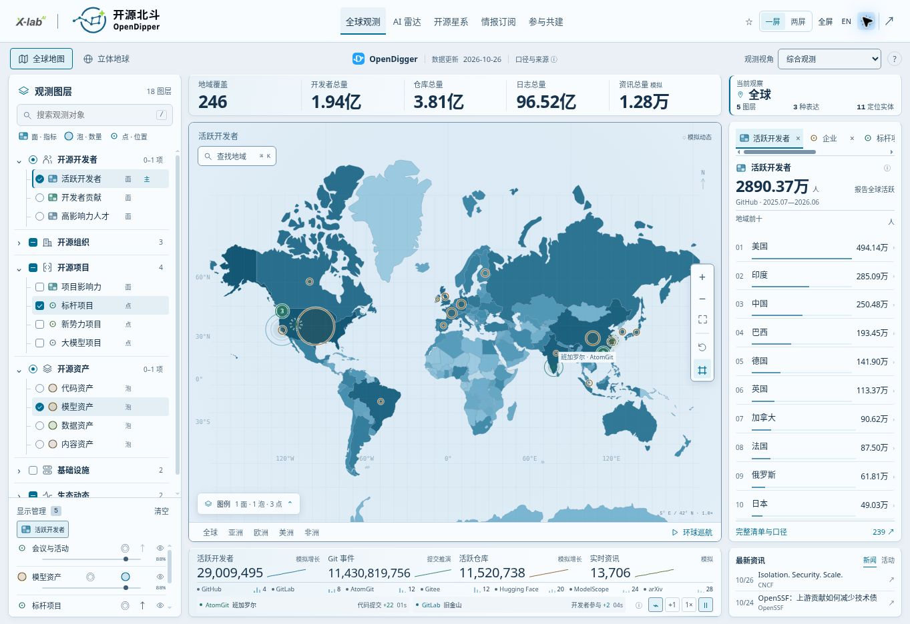
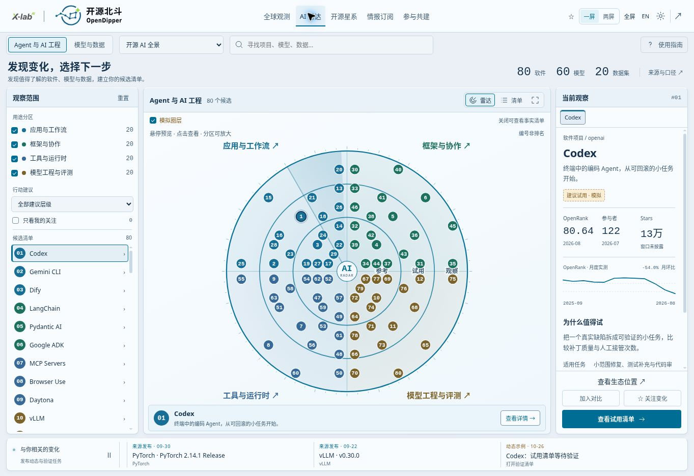
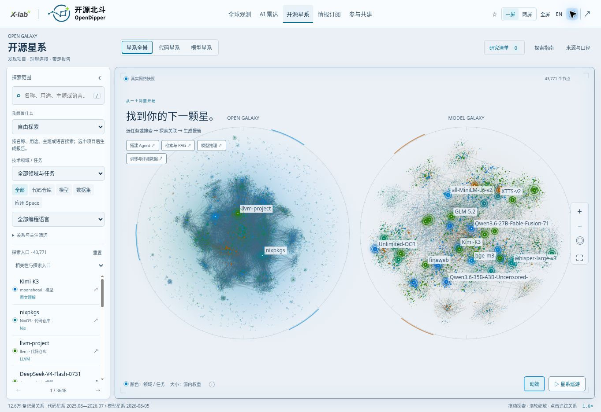
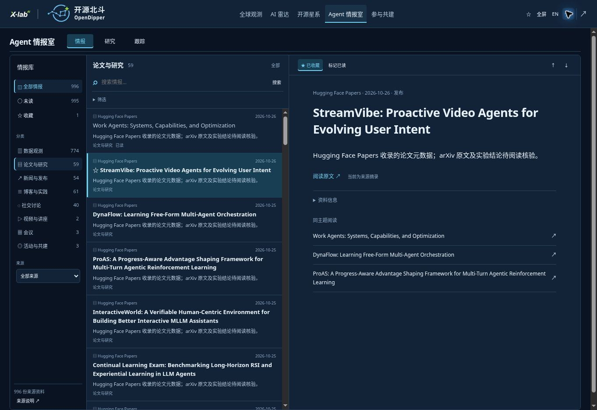
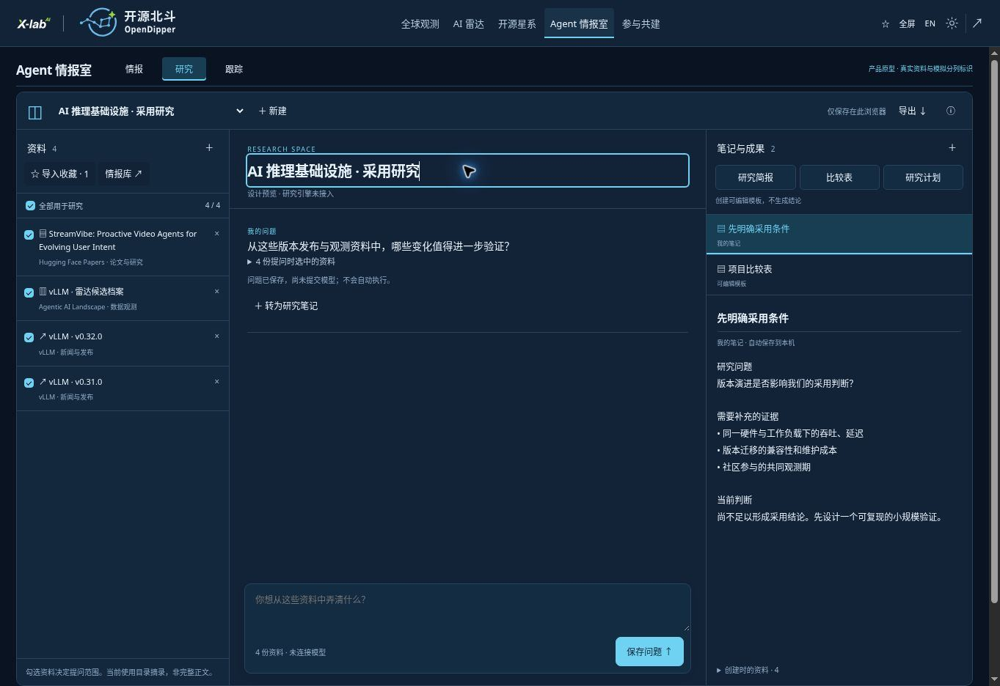
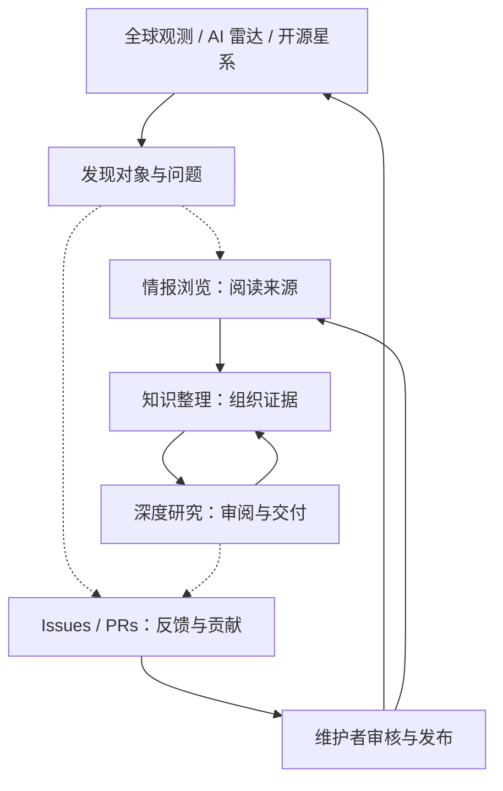
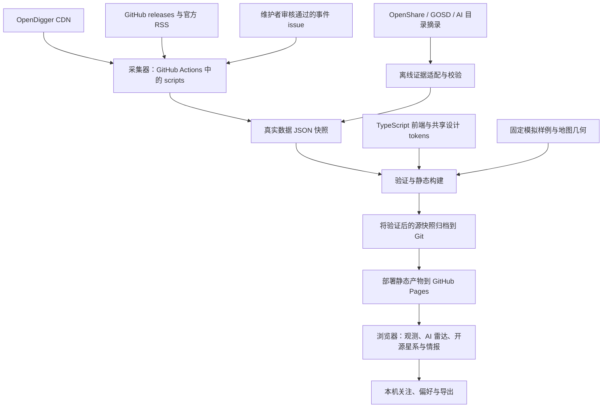

<!-- section:overview -->

# OpenDipper · 开源北斗

<picture>
  <source media="(prefers-color-scheme: dark)" srcset="public/brand/opendipper/opendipper-horizontal-dark.svg">
  
</picture>

[English](README.md) | **简体中文**

**开源北斗将 AI 与开源生态数据，转化为可探索的线索、可整理的知识和可审阅的研究报告。** 开发者可以发现和比较项目，研究者与生态团队可以查证资料、组织专题、准备决策。全球观测、AI 雷达和开源星系帮助你发现问题；Agent 情报室承接资料阅读、知识整理与报告交付。

[进入观测站](https://www.x-lab.info/open-dipper/) · [AI 雷达](https://www.x-lab.info/open-dipper/#radar) · [开源星系](https://www.x-lab.info/open-dipper/#ecosystem) · [Agent 情报室](https://www.x-lab.info/open-dipper/#briefing) · [参与贡献](CONTRIBUTING.zh-CN.md) · [路线图](ROADMAP.zh-CN.md)

**第一版已交付（应用 1.15.1）：**[五模块里程碑、验证与待完成边界](docs/releases/first-edition.md) · **[B 站观看正式宣传片](https://www.bilibili.com/video/BV1J3xL63EPP/)** · [58 秒五模块宣传片、分镜与复现](media/promo/README.md)。短片以全球观测上游统计呈现全域发现愿景；当前雷达仍是有来源的预览样本，后续分阶段接入。

<!-- section:first-exploration -->
## 完成你的第一次探索

1. [打开 vLLM / SGLang 案例](https://www.x-lab.info/open-dipper/#briefing?tab=signals&case=inference)，阅读六份官方来源。
2. 收录到**知识整理**，勾选本次研究使用的资料，点击**带入深度研究**。
3. 查看完整**编辑示例**，回查引用、修改报告，导出 Markdown 或可打印 HTML，也可以将成果存回知识库。

无需 API 密钥即可体验。该流程演示从证据到报告的交互，**不是 DSH 实时执行或性能实测**。内容保存在当前浏览器，清理存储前请导出。若想探索项目关系，可以在开源星系搜索 PyTorch；记录的共享贡献者连线不等于软件依赖或质量排名。

**你发现了什么，在哪一步卡住了？** 欢迎[分享第一次探索体验](https://github.com/X-lab2017/open-dipper/issues/35)。如果工具对你有用，可以 Star 留作后续探索；使用反馈与来源纠错同样欢迎。

<!-- section:product -->
## 你可以做什么

| 模块 | 解决的问题 | 当前范围 |
| --- | --- | --- |
| 全球观测 | 在地图或地球上探索参与、贡献、影响力与生态事件 | 六类十八层、图层叠加、当前观察多标签、排行榜与一/两屏演示 |
| AI 雷达 | 按任务发现候选、检查来源、同类对比并导出试用清单 | 160 个有来源实体：80 个软件、60 个模型、20 个数据集；本机关注；可关闭的**模拟**圈层判断 |
| 开源星系 | 按任务找项目、建立候选清单、追踪记录关系，导出有来源的研究报告 | 19,771 个代码仓库 + 24,000 个模型/数据/Space 节点；记录关系与推断分离；[模块契约](docs/OPEN_GALAXY.md) |
| Agent 情报室 | 浏览情报 → 整理知识 → 发起研究 → 审阅与交付报告 | 本机工作区；完整 vLLM/SGLang 编辑案例；DSH 适配代码已准备，运行服务未接通 |
| 共建社区 | 了解愿景、路线与参与方式 | 动态项目介绍、[里程碑时间线](https://www.x-lab.info/open-dipper/#contribute?view=milestones)、来源与权利披露、GitHub 共建入口；[契约](docs/COMMUNITY_HUB.md) |

**应用版本：1.18.0；视觉体系：1.4.1；地图／雷达固定基线：1.3.2。** 全球地图重新居中，默认打开活跃开发者，并以五站“环球巡航”串联企业、项目、模型和活动。[实现与验收](docs/plans/observatory-tour.md)。 [当前状态与限制](docs/STATUS.md) · [可复用基线](design/baselines/README.md) · [数据口径](docs/DATA_EVIDENCE.md)。各数据保留独立观察期，模拟脉动不是实时测量；公开可下载不代表每个模型或数据集都符合开源定义。

### 全球观测——找到观察重点

从宏观生态问题出发，组合地域图层，再聚焦地区或实体，查看排行、指标和有来源的事件。不同观察期与样本范围始终保留，不把所有图层混算成同一全球总量。

<a href="https://www.x-lab.info/open-dipper/">
  <picture>
    <source media="(prefers-color-scheme: dark)" srcset="docs/assets/opendipper-1.6.0-atlas-dark-20261027.jpg">
    
  </picture>
</a>

*2026-10-27 线上截图，随明暗偏好切换；截图日期不替代数据观察期。[图片来源与压缩说明](docs/assets/README.md)。*

### AI 雷达——形成试用清单

选择任务，发现相关软件、模型或数据集，检查来源证据，对比同类候选，再导出试用清单。可选的模拟圈层判断与来源事实保持独立。

<a href="https://www.x-lab.info/open-dipper/#radar">
  <picture>
    <source media="(prefers-color-scheme: dark)" srcset="docs/assets/opendipper-1.6.0-radar-dark-20261027.jpg">
    
  </picture>
</a>

*2026-10-27 线上截图，随明暗偏好切换；截图日期不替代数据观察期。[图片来源与压缩说明](docs/assets/README.md)。*

### 开源星系——理解连接，带走报告

按任务或名称找到项目，查看记录关系邻域，加入最多三个研究对象，追踪记录路径，导出 Markdown、HTML 或 JSON 证据报告。报告保留缺失证据和来源日期，不等同于实时研究、安全审计或采用建议。

<a href="https://www.x-lab.info/open-dipper/#ecosystem">
  <picture>
    <source media="(prefers-color-scheme: dark)" srcset="docs/assets/opendipper-1.6.0-galaxy-dark-20261027.jpg">
    
  </picture>
</a>

*2026-10-27 线上截图，随明暗偏好切换；截图日期不替代数据观察期。[图片来源与压缩说明](docs/assets/README.md)。*

### Agent 情报室——从资料走到交付

**情报浏览｜知识整理｜深度研究**分别负责阅读、知识加工和研究交付。情报页借鉴 Folo 的资料库／列表／阅读三栏；知识页借鉴 Open Notebook 的资料选择与笔记组织；研究页围绕问题、证据、报告与交付展开。





*阅读与知识整理截图来自此前迭代，不代表新增深度研究页面。当前完整操作路径与边界见[流程指南](docs/INTELLIGENCE_WORKFLOW.md)。*

来源目录是有界样本，不是全网覆盖。Folo、Open Notebook 是交互参考，未嵌入其服务。DSH 是选定的执行方向；[服务端适配说明](services/research/README.md)仍要求独立运行服务、匹配的 SDK、模型和带身份验证的网关。未接通时运行按钮禁用，演示为独立入口。尚无云同步、自动跟踪或通知投递。

<!-- section:participation -->
## 从问题或一份小贡献开始

提出建议不需要懂代码。Issue 欢迎中文和英文。

| 我想…… | 从这里开始 |
| --- | --- |
| 描述需求或建议新能力 | [功能需求](https://github.com/X-lab2017/open-dipper/issues/new?template=feature_request.yml)——谁需要、什么场景、期望什么结果 |
| 报告功能异常 | [问题反馈](https://github.com/X-lab2017/open-dipper/issues/new?template=bug_report.yml)——步骤、实际表现和预期表现 |
| 更正数字、实体、地点或归属 | [数据纠错](https://github.com/X-lab2017/open-dipper/issues/new?template=data_correction.yml)——受影响条目与来源证据 |
| 评审可读性或交互 | [体验反馈](https://github.com/X-lab2017/open-dipper/issues/new?template=experience_feedback.yml)——具体任务，以及顺畅或受阻的地方 |
| 提交有来源的资讯 | [事件提交](https://github.com/X-lab2017/open-dipper/issues/new?template=ecosystem-event.yml)——之后由维护者独立审核 |
| 完成第一次贡献 | [贡献指南](CONTRIBUTING.zh-CN.md)——来源目录、术语和内容任务 |

提交前先搜索已有 issue；相同问题可以直接补充证据。意见、文档、翻译、来源核验和代码都能帮助项目改进。

<!-- section:collaboration -->
## 人主导方向，Agent 承担工程执行

人提供需求、领域知识与产品评审；Agent 是主要工程协作者，读取版本化上下文、完成有边界的实现、验证结果并留下可复现的交接。人类开发者同样欢迎参与代码贡献。

**需求 → 有边界的 issue → 实现 → 验收证据 → 结果评审。** 维护者负责方向和发布；提交 issue 不会自动启动 Agent。[Harness 工作流](docs/HARNESS.md) 明确区分现有检查与未来自动化。

- **参与者：** [贡献指南](CONTRIBUTING.zh-CN.md) → 实时 issue → 商定一份小贡献。
- **Agent：** [AGENTS.md](AGENTS.md) → [当前状态](docs/STATUS.md) → [任务上下文](docs/CONTEXT.json)。
- **评审者：** [评审路线](docs/REVIEW.md) → 可复现证据 → 在 issue/PR 中反馈。

<!-- section:business -->
## 业务视角



虚线表示用户主动衔接，不代表跨模块自动传递上下文或公开分享。**[共建社区](https://www.x-lab.info/open-dipper/#contribute)**介绍项目愿景、四模块概念动态图、发展路线和参与方式，连接 GitHub 协作入口。见[实现契约](docs/COMMUNITY_HUB.md)；不会自动提交或公开私人知识库。

<!-- section:development -->
## 本地运行

使用 Node.js 24、npm 和 Python 3。安装依赖后，可使用仓库快照开发，无需凭据或重新采集上游数据。

```sh
npm ci
npm run dev
```

```sh
npm run typecheck
npm test
npm run build
```

纯文档修改：先运行 `npm run docs:build`，再运行 `npm run docs:check`。[开发指南](docs/DEVELOPMENT.md) 提供任务检查、浏览器复现和生成文件说明。来源和部署快照各自保留日期。

<!-- section:architecture -->
## 技术视角



PR 验证变更；符合条件的 main 工作流采集、归档并部署快照。没有公共写入 API 或客户端凭据。详见[架构](docs/ARCHITECTURE.md)与[运维](docs/OPERATIONS.md)。

<!-- section:documentation -->
## 找到所需上下文

| 目标 | 文档 |
| --- | --- |
| 了解当前能力与缺口 | [当前状态](docs/STATUS.md) · [路线图](ROADMAP.zh-CN.md) |
| 复用已接受的设计 | [基线索引](design/baselines/README.md) · [模块模板](docs/templates/OBSERVATORY_MODULE.md) · [品牌资产](public/brand/opendipper/README.md) |
| 理解决策与迭代过程 | [历史](docs/HISTORY.md) · [决策](docs/DECISIONS.md) |
| 查找工程知识 | [文档导航](docs/README.md) · [机器任务索引](docs/CONTEXT.json) |

<!-- section:transparency -->
## 披露与复用

AI Agent 参与了实现、视觉迭代和仓库维护。贡献应披露参与范围、实际验证与剩余不确定项，无需公开私人提示词或聊天。观测事实、未知值和固定演示保持区分。

OpenDipper 独立实现。空间交互参考 [world-monitor.com](https://world-monitor.com/)，工程参考包括另一个独立项目 [koala73/worldmonitor](https://github.com/koala73/worldmonitor)。仓库保留来源与品牌声明。

**许可决策仍待确认：** 尚未选定应用代码根 LICENSE。源码、数据集、地图与品牌资产各有权利边界，公开可见不代表统一授权。详见[权利说明](docs/RIGHTS.md)与[决策 #6](https://github.com/X-lab2017/open-dipper/issues/6)。敏感报告请遵循 [SECURITY.md](SECURITY.md)。

会议与活动现收录 Conference Partner 的 392 条 CCF 标注会议与 2 场社区活动，支持日程筛选和城市地图；等级为第三方标注，未定位记录保留。见 [数据与更新契约](docs/CONFERENCES.md)。
