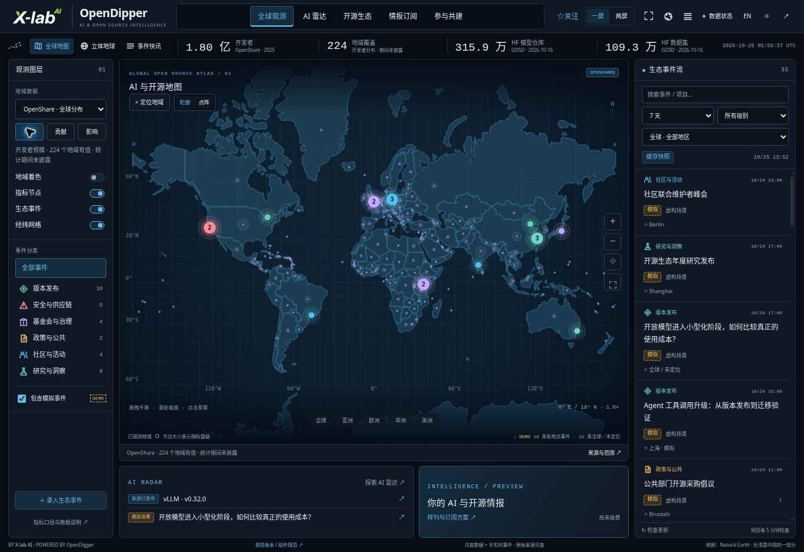
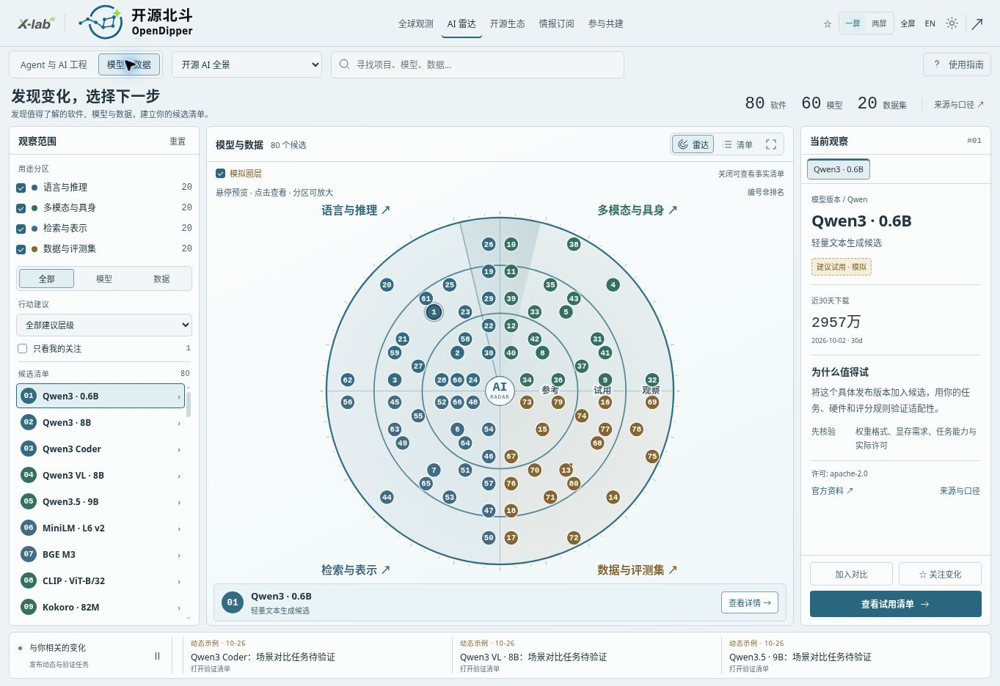
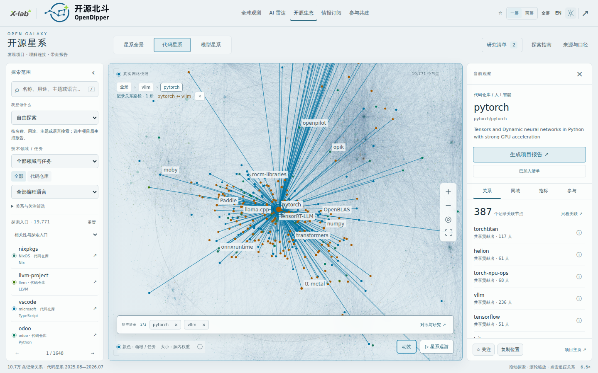
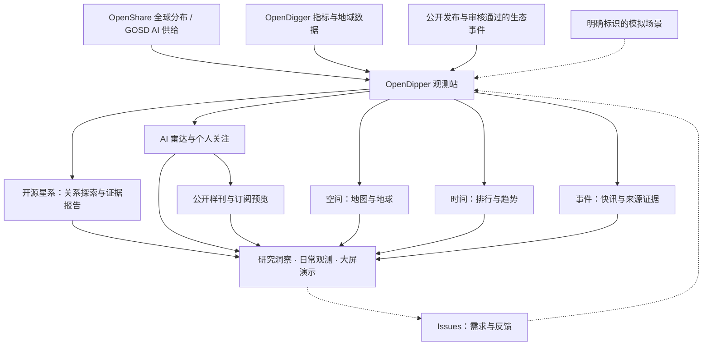
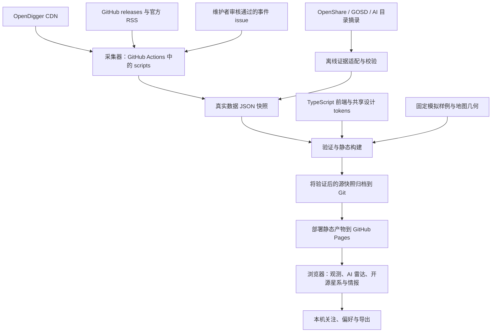

<!-- section:overview -->
# OpenDipper · 开源北斗

<picture>
  <source media="(prefers-color-scheme: dark)" srcset="public/brand/opendipper/opendipper-horizontal-dark.svg">
  
</picture>

[English](README.md) | **简体中文**

**观察全球 AI 与开源生态，发现相关项目，查阅证据，决定下一步尝试什么。** 开源北斗连接全球空间观测、任务式 AI 雷达与可深入探索的开源星系，为开发者、研究者和生态社区提供探索入口。

[进入观测站](https://www.x-lab.info/open-dipper/) · [AI 雷达](https://www.x-lab.info/open-dipper/#radar) · [开源星系](https://www.x-lab.info/open-dipper/#ecosystem) · [参与贡献](CONTRIBUTING.zh-CN.md) · [路线图](ROADMAP.zh-CN.md)

<!-- section:first-exploration -->
## 完成你的第一次探索

1. 打开[开源星系](https://www.x-lab.info/open-dipper/#ecosystem)，搜索 **PyTorch**，或一个你正在使用的项目。
2. 选中项目，查看记录关系邻居，把感兴趣的候选加入研究清单。以 PyTorch 为例，可以探索它与 **vLLM** 的记录关联。
3. 打开研究清单中的“对照与研究”，查看来源，再导出 **Markdown、HTML 或 JSON** 报告。

代码星系的连线表示采样期内的共享贡献者关联，不等于软件依赖或质量排名。报告保留来源和证据缺口，供你继续查证。

**你发现了什么，在哪一步卡住了？** 欢迎[分享第一次探索体验](https://github.com/X-lab2017/open-dipper/issues/35)。如果工具对你有用，可以 Star 留作后续探索；使用反馈与来源纠错同样欢迎。

<!-- section:product -->
## 你可以做什么

| 模块 | 解决的问题 | 当前范围 |
| --- | --- | --- |
| 全球观测 | 在地图或地球上探索参与、贡献、影响力与生态事件 | 六类十八层、图层叠加、当前观察多标签、排行榜与一/两屏演示 |
| AI 雷达 | 按任务发现候选、检查来源、同类对比并导出试用清单 | 160 个有来源实体：80 个软件、60 个模型、20 个数据集；本机关注；可关闭的**模拟**圈层判断 |
| 开源星系 · 1.5.1 | 按任务找项目、建立候选清单、追踪记录关系，导出有来源的研究报告 | 19,771 个代码仓库 + 24,000 个模型/数据/Space 节点；记录关系与推断分离；[模块契约](docs/OPEN_GALAXY.md) |
| 情报 | 阅读公开样刊并保存关注主题 | 浏览器本地偏好；订阅交付和付费服务仍为规划 |

**当前发布版本：1.5.1；已接受的地图／雷达基线：1.3.2。** [当前状态与限制](docs/STATUS.md) · [可复用基线](design/baselines/README.md) · [数据口径](docs/DATA_EVIDENCE.md)。各数据保留独立观察期，模拟脉动不是实时测量；公开可下载不代表每个模型或数据集都符合开源定义。

### 全球观测——找到观察重点

从宏观生态问题出发，组合地域图层，再聚焦地区或实体，查看排行、指标和有来源的事件。不同观察期与样本范围始终保留，不把所有图层混算成同一全球总量。

[](https://www.x-lab.info/open-dipper/)

*全球观测实现评审图，2026-10-25；保留的历史画面不代表当前数据。[地图/地球交互与当前图层契约](docs/ATLAS_WORKSPACE.md)。*

### AI 雷达——形成试用清单

选择任务，发现相关软件、模型或数据集，检查来源证据，对比同类候选，再导出试用清单。可选的模拟圈层判断与来源事实保持独立。

[](https://www.x-lab.info/open-dipper/#radar)

*AI 雷达 1.3.2 实现评审图，2026-10-26。[明暗效果与交互契约](docs/AI_RADAR.md)。*

### 开源星系——理解连接，带走报告

按任务或名称找到项目，查看记录关系邻域，加入最多三个研究对象，追踪记录路径，导出 Markdown、HTML 或 JSON 证据报告。报告保留缺失证据和来源日期，不等同于实时研究、安全审计或采用建议。

[](https://www.x-lab.info/open-dipper/#ecosystem)

*开源星系 1.5.1 浅色 CI 验收截图，2026-10-26：PyTorch–vLLM 记录路径与研究清单。浏览器验收覆盖深浅主题、手机布局及 Markdown/HTML/JSON 三格式实际下载；此图不是生产站点截图。[研究与关系契约](docs/OPEN_GALAXY.md) · [正式发布验收记录](docs/plans/ecosystem-public-release.md)。*

<!-- section:participation -->
## 从问题或一份小贡献开始

提出建议不需要懂代码。Issue 欢迎中文和英文。

| 我想…… | 从这里开始 |
| --- | --- |
| 描述需求或建议新能力 | [功能需求](https://github.com/X-lab2017/open-dipper/issues/new?template=feature_request.yml)——谁需要、什么场景、期望什么结果 |
| 报告功能异常 | [问题反馈](https://github.com/X-lab2017/open-dipper/issues/new?template=bug_report.yml)——步骤、实际表现和预期表现 |
| 更正数字、实体、地点或归属 | [数据纠错](https://github.com/X-lab2017/open-dipper/issues/new?template=data_correction.yml)——受影响条目与来源证据 |
| 评审可读性或交互 | [体验反馈](https://github.com/X-lab2017/open-dipper/issues/new?template=experience_feedback.yml)——具体任务，以及顺畅或受阻的地方 |
| 提交有来源的资讯 | [事件提交](https://github.com/X-lab2017/open-dipper/issues/new?template=ecosystem-event.yml)——之后由维护者独立审核 |
| 完成第一次贡献 | [贡献指南](CONTRIBUTING.zh-CN.md)——来源目录、术语和内容任务 |

提交前先搜索已有 issue；相同问题可以直接补充证据。意见、文档、翻译、来源核验和代码都能帮助项目改进。

<!-- section:collaboration -->
## 人主导方向，Agent 承担工程执行

人提供需求、领域知识与产品评审；Agent 是主要工程协作者，读取版本化上下文、完成有边界的实现、验证结果并留下可复现的交接。人类开发者同样欢迎参与代码贡献。

**需求 → 有边界的 issue → 实现 → 验收证据 → 结果评审。** 维护者负责方向和发布；提交 issue 不会自动启动 Agent。[Harness 工作流](docs/HARNESS.md) 明确区分现有检查与未来自动化。

- **参与者：** [贡献指南](CONTRIBUTING.zh-CN.md) → 实时 issue → 商定一份小贡献。
- **Agent：** [AGENTS.md](AGENTS.md) → [当前状态](docs/STATUS.md) → [任务上下文](docs/CONTEXT.json)。
- **评审者：** [评审路线](docs/REVIEW.md) → 可复现证据 → 在 issue/PR 中反馈。

<!-- section:business -->
## 业务视角



<!-- section:development -->
## 本地运行

使用 Node.js 24、npm 和 Python 3。安装依赖后，可使用仓库快照开发，无需凭据或重新采集上游数据。

```sh
npm ci
npm run dev
```

```sh
npm run typecheck
npm test
npm run build
```

纯文档修改：先运行 `npm run docs:build`，再运行 `npm run docs:check`。[开发指南](docs/DEVELOPMENT.md) 提供任务检查、浏览器复现和生成文件说明。来源和部署快照各自保留日期。

<!-- section:architecture -->
## 技术视角



PR 验证变更；符合条件的 main 工作流采集、归档并部署快照。没有公共写入 API 或客户端凭据。详见[架构](docs/ARCHITECTURE.md)与[运维](docs/OPERATIONS.md)。

<!-- section:documentation -->
## 找到所需上下文

| 目标 | 文档 |
| --- | --- |
| 了解当前能力与缺口 | [当前状态](docs/STATUS.md) · [路线图](ROADMAP.zh-CN.md) |
| 复用已接受的设计 | [基线索引](design/baselines/README.md) · [模块模板](docs/templates/OBSERVATORY_MODULE.md) · [品牌资产](public/brand/opendipper/README.md) |
| 理解决策与迭代过程 | [历史](docs/HISTORY.md) · [决策](docs/DECISIONS.md) |
| 查找工程知识 | [文档导航](docs/README.md) · [机器任务索引](docs/CONTEXT.json) |

<!-- section:transparency -->
## 披露与复用

AI Agent 参与了实现、视觉迭代和仓库维护。贡献应披露参与范围、实际验证与剩余不确定项，无需公开私人提示词或聊天。观测事实、未知值和固定演示保持区分。

OpenDipper 独立实现。空间交互参考 [world-monitor.com](https://world-monitor.com/)，工程参考包括另一个独立项目 [koala73/worldmonitor](https://github.com/koala73/worldmonitor)。仓库保留来源与品牌声明。

**许可决策仍待确认：** 尚未选定应用代码根 LICENSE。源码、数据集、地图与品牌资产各有权利边界，公开可见不代表统一授权。详见[权利说明](docs/RIGHTS.md)与[决策 #6](https://github.com/X-lab2017/open-dipper/issues/6)。敏感报告请遵循 [SECURITY.md](SECURITY.md)。
