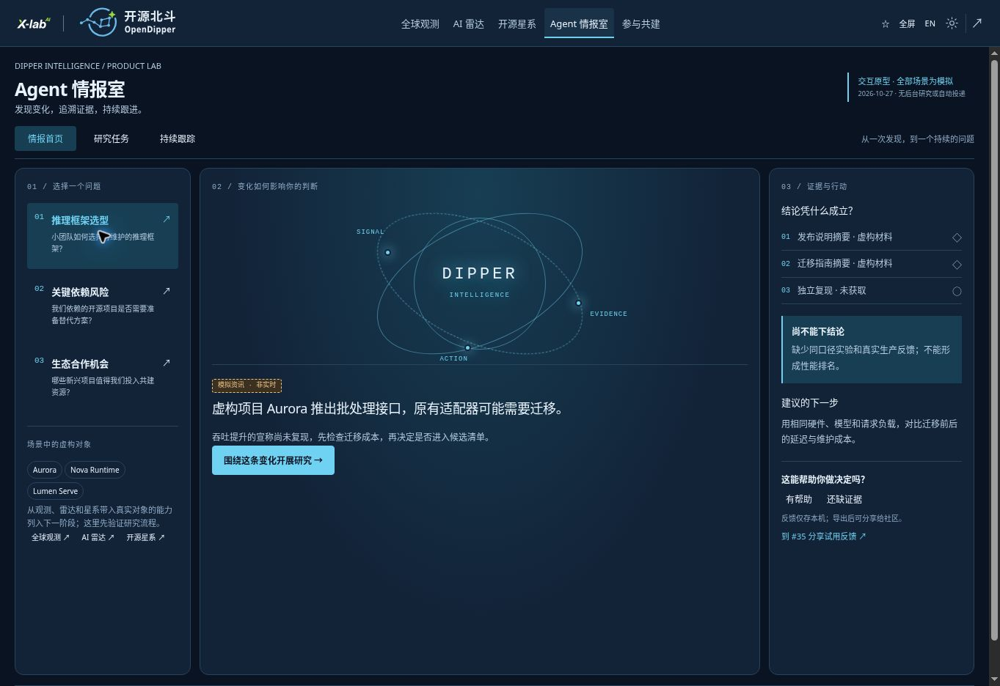
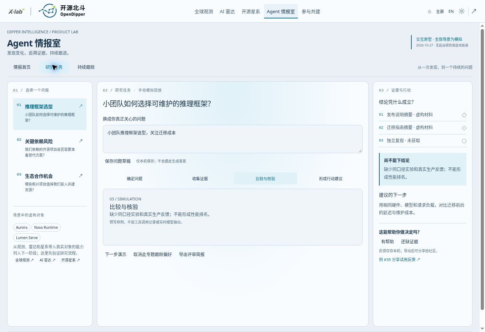

# Agent 情报室 / Agent Intelligence Room

Product specification v0.1 · 2026-10-27 · **interactive prototype, not a live Agent service**.

## 中文评审摘要

本轮把“情报订阅”合入“Agent 情报室”，先验证产品价值，再接入真实服务。主导航与前三个模块保持原结构。

- **情报首页**：围绕技术选型、关键依赖风险、生态合作机会，解释一条变化为何值得关注。
- **研究任务**：按“确定问题—收集证据—比较核验—行动建议”手动查看模拟过程；可以保存自己的问题，但不会据此生成答案。
- **持续跟踪**：保存专题、触发条件与频率；当前仅本机偏好，不会自动采集或发送通知。
- **证据与反馈**：展示虚构材料位置与真实缺口，不伪造来源或置信度；可以导出带模拟标记的评审简报，反馈入口沿用 #35。

建议先邀请 5–8 位愿意参与的开发者和研究用户，以一个真实决策为起点体验。重点记录是否理解证据、下一步是否可执行、是否愿意持续回来；这些是拟定的评审安排，尚未开展招募或获得结果。

后续按“真实专题样刊 → 有预算和可恢复状态的 Agent 研究 → 经同意的订阅交付 → 机构协作空间”推进。首选试点为 AI 推理基础设施。继续免费积累用户，商业服务由 OpenShare 承接；收费与权益仍需单独确认。

## Product decision

Merge the subscription entry into **Agent 情报室 · Dipper Intelligence**. Research answers a question; following keeps the answer current; evidence and saved reports preserve context. The first three product modules and their data contracts remain intact. Keep `#briefing` compatible; do not introduce another top-level navigation item.

This branch implements a local, bilingual prototype with three views: Intelligence, Research, Following. It does not claim deployed production availability. Research is a **manual, scripted simulation**. No inference, collection, delivery, payment or external posting occurs. Current public sample and original topic preferences remain reachable in an expandable section. Existing local watchlists are not migrated or removed.

## Who and what to validate

| User | Decision | First hypothesis |
| --- | --- | --- |
| Developer / small engineering team | Which dependency should we trial or retain? | A sourced change plus a bounded next experiment saves investigation time |
| Researcher / ecosystem contributor | Which emerging project deserves attention? | Evidence gaps and relationship context improve topic selection |
| Institutional research team | What changed in a strategic technology landscape? | Shared questions, comparable evidence and decision history support recurring work |

Start a real pilot with **AI inference infrastructure**, then widen only when repeated use and evidence quality justify it. The prototype's Aurora, Harbor, Polaris and related names are fictional. They are not aliases for real projects or endorsements.

## Experience and prototype contract

- Compact shared shell, paired light/dark tokens, three columns; mobile natural flow. Decorative orbital artwork communicates signal → evidence → action, not a measured network.
- Three selectable scenarios, dated 2026-10-27. Switching scenarios changes the question, fictional update, caveat, evidence slots and action. Missing evidence has no invented URL or confidence score.
- Research steps are directly selectable and manually advanced; there is no fake elapsed time, simulated completion toast, running-agent count or fabricated tool log.
- Custom question: at most 600 characters, editable draft only. Saving does not alter the scripted sample answer or execute research. The draft is a shared scratchpad across scenarios; the export distinguishes it from the example question.
- Following saves selected scenario IDs and shared trigger/cadence preferences. It does not activate alerts. Empty, selected and removed states are visible; clear affects only `od:agent-room`.
- Export produces Markdown carrying DEMO, fixed fixture date, fictional evidence, missing evidence, custom question and local rule/feedback state.
- Feedback buttons save only locally; no analytics or submission is implied. Share an exported review manually in existing [#35](https://github.com/X-lab2017/open-dipper/issues/35); no automatic GitHub comment.
- Original `od:intelligence` preferences and old public sample are independent. This separation is temporary for backward compatibility; real account migration requires an explicit design.
- `src/intelligence-room/model.ts` owns static fixtures, bounded state normalization and export. `view.ts` owns local interaction; `room.css` uses existing visual tokens. No backend dependencies or secrets.

## Joint user evaluation

Ask participants to complete one task without guidance, then discuss:

1. Which real decision would this help you make? What would you otherwise use?
2. Can you distinguish observed fact, inference, missing evidence and simulation?
3. Which change warrants an interruption, and which belongs in a weekly digest?
4. What evidence would make you act, and what remains missing?
5. Would you return for the same question next week? Who else needs the result?

Suggested exploratory cohort: 5–8 consenting users across developers and research/enterprise teams. These are proposed targets, **not recruited participants or results**. Record task completion, evidence comprehension, actionable next steps, stated alternative and voluntary return use. Do not infer willingness to pay from clicks or decorative engagement. Capture actual baseline time before claiming saved time. Keep private interview details out of public issues; public feedback is optional.

Advance to a live pilot when several participants independently identify the same recurring decision and can explain how the proposed evidence changes it. Choose explicit pilot thresholds with the maintainer before measurement; do not invent percentages after the fact.

## Future Agent design — not implemented

Use one bounded research orchestrator with typed tools initially; specialized workers are an option after evaluation, not a UI requirement. User-facing progress reflects real persisted task events, not internal chain-of-thought.

| Layer | Required behavior |
| --- | --- |
| Question contract | Objects, decision, constraints, time window, allowed sources, run budget, completion criteria |
| Evidence retrieval | Read-only allowlisted adapters, canonical IDs, publication/capture/observation times, versioned excerpts, rights and access checks |
| Research execution | Plan → retrieve → compare → challenge claims → report; bounded retries, checkpoints, cancellation and resumability |
| Judgment | Separate sourced claims, derived metrics, hypotheses, contradictory evidence and unavailable inputs; attach citations at claim level |
| Review | Human review for consequential recommendations and externally delivered institutional reports; no automated license decision or outreach |
| Following | Scheduler, change detection, deduplication, quiet periods, correction/retraction, consent, unsubscribe and delivery receipts |
| Persistence | Workspace isolation, task/event history, evidence versions, retention and deletion/export controls |
| Evaluation | Citation entailment, missing/false alerts, temporal consistency, source conflicts, user usefulness, cost per accepted deliverable |

Remote sources, repository content and documents are untrusted evidence, never permission to call tools or expand scope. Separate tool permissions from retrieved text. Server credentials stay off Pages. Public data and private institutional documents must have separate access boundaries. No unlimited research triggered by every incoming event.

Proposed durable entities: `ResearchQuestion`, `TrackedObject`, `EvidenceRecord`, `Claim`, `ResearchRun`, `BriefRevision`, `TrackingRule`, `DeliveryReceipt`, `UserAssessment`. Store source IDs and time scopes rather than mixing global aggregates with local research coverage. Do not promote inferred graph relationships to recorded facts.

A real deployment requires a backend for identity, jobs, evidence, quotas and delivery; Pages remains the public client. Evaluate providers, model/tool interfaces and operating costs during the backend spike against then-current official documentation. No provider or framework is selected by this prototype.

## Commercial path

Public observation → useful personal research → recurring following → shared institutional intelligence. X-lab supports open research/methods/community; OpenShare carries commercial workspaces and service operations. A homepage link is not account or entitlement integration.

Continue free platform acquisition under the agreed strategy. Any charging milestone requires a separate maintainer decision; no registration count or launch date is claimed here. Validate institutional needs through existing research and consulting activities without claiming that paid platform access is live.

Future institutional value: shared topics, private evidence, reproducible reports, access control and reliable delivery. Candidate charging units are workspace + bounded monitoring/research allowance, subject to actual cost and value validation. Include inference, retrieval, review and support costs; donated developer Token entitlements are not an unlimited inference budget. Sponsorship must not change rankings or research conclusions.

## Delivery stages and dependencies

| Stage | Deliverable / gate | Existing coordination |
| --- | --- | --- |
| Product review (this branch) | Interactive scripted scenarios, feedback/export, documented boundaries and visual QA | #35 feedback |
| Evidence pilot | One actual topic, original sources, claim-evidence checks, repeat user value | #15, #16, #18, #19 |
| Bounded live Agent | Real job states, cancellation, budgets, evaluation, reviewed report; failures visible | #15, #18 |
| Delivery | Consent, identity, synchronization, reliable sends, unsubscribe | #17 |
| Institutional workspace | Proven recurring need, isolated data, review and measured unit economics | #17; new scope only after deduplication |

Cross-module “research this object” is planned, not implemented: it must carry canonical identity, selected evidence and original scope from Atlas/Radar/Galaxy. This prototype provides navigation back to these modules, not fabricated context transfer.
