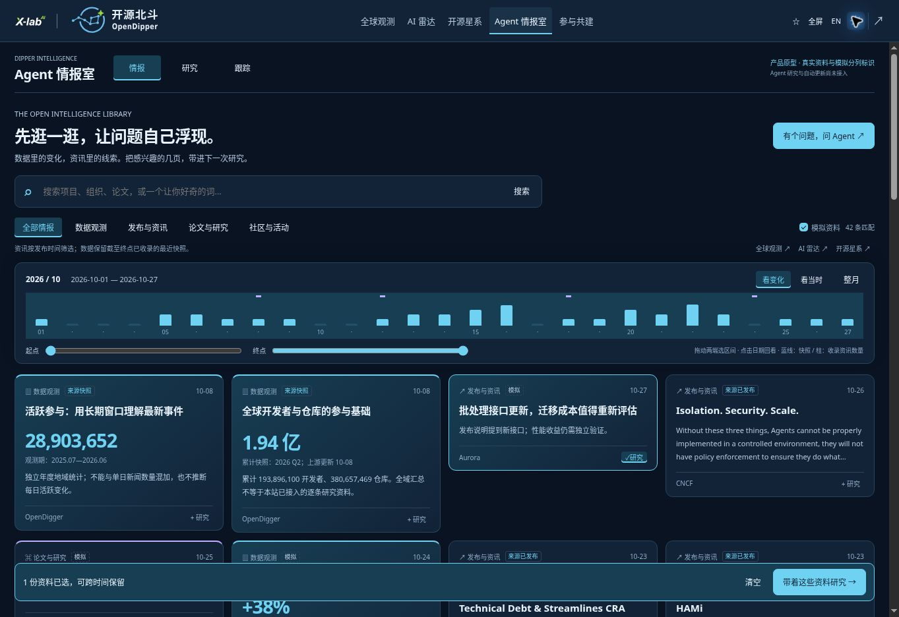
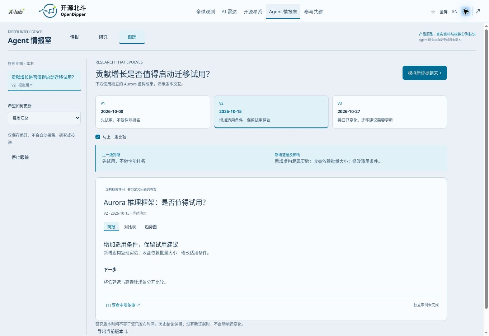

# Agent 情报室 / Agent Intelligence Room

Historical product specification v0.3 · 2026-10-27 · **interactive prototype, not a live Agent service**.

> Current Research implementation: [Research space 1.12.0](RESEARCH_SPACE.md). Current reading: [Intelligence library](INTELLIGENCE_LIBRARY.md). The sections below retain earlier prototype decisions; the former research landing is now under Earlier drafts & version examples.

## 中文评审摘要 / Review v0.3

1.7.0 扩展为八类资料、六个主题的公共情报库；多来源采集、对象关联、分类统计和连续滚动的实际范围见 [情报库契约](INTELLIGENCE_LIBRARY.md)。研究与跟踪仍为本机产品原型。

从“先选场景”调整为 **先浏览 → 产生问题 → 带资料研究 → 持续回看**。前三个模块与主导航结构保留。

- **情报**：同屏翻阅真实全球观测快照、已采集公开资讯和可关闭的虚构材料。来源标签、原文链接、统计周期可检查；不把全域总量当作本地知识库覆盖量。
- **时间轴**：原型固定在 2026 年 10 月。双端选区间看资讯变化；点日期看当时已收录材料。数据快照按收录时间保留背景，不能当作每日观测。快照先展示，资讯按发布时间倒序；时间轴数量仅代表此资料集。
- **研究**：自由提问，携带跨日期选中的资料和时间范围，保存本机研究草案。右侧提供独立的虚构 Aurora 成果，可以切换简报、比较表与趋势图；不会假装回答自定义问题。
- **跟踪**：将草案加入专题，手动模拟新证据、切换历史版本、比较结论变化。更新频率只是本机偏好，没有自动研究或投递。

原型用于评审浏览启发和研究衔接，不是已接入的 Agent 服务。公开样刊及旧偏好保留在折叠区域。维护者已授权本轮随 1.7.0 发布到正式 Pages；部署结果以 Actions 为准。v0.1 的固定三场景和轨道装饰已被本次浏览式设计替代；旧截图仅作历史记录。

## Product decision

Keep **Agent 情报室 · Dipper Intelligence** as the single entry for Intelligence, Research and Following. Subscription is a future delivery preference of followed research, not a separate homepage. Preserve `#briefing`, the first three modules and existing sample/preferences.

The knowledge library combines actual source snapshots and captured public events with separately labelled, removable fictional fixtures. It offers browsing before a question exists. Timeline range mode filters event publication dates; as-known mode also respects capture dates. Snapshot observation periods remain explicit. The fixed October 2026 lens is supplemented by an archive date range. This is not a complete historical archive.

Free questions create local drafts with selected evidence; a fixed plan and independent fictional report illustrate the intended experience. Following demonstrates three report versions and their changes. No inference, collection, notifications, payment or external posting occurs. The library now incorporates radar profiles and a bounded galaxy sample with source URLs. Full corpus indexing and cross-module selection transfer remain future work.

## Who and what to validate

| User | Decision | First hypothesis |
| --- | --- | --- |
| Developer / small engineering team | Which dependency should we trial or retain? | A sourced change plus a bounded next experiment saves investigation time |
| Researcher / ecosystem contributor | Which emerging project deserves attention? | Evidence gaps and relationship context improve topic selection |
| Institutional research team | What changed in a strategic technology landscape? | Shared questions, comparable evidence and decision history support recurring work |

Start a real pilot with **AI inference infrastructure**, then widen only when repeated use and evidence quality justify it. The prototype's Aurora, Harbor, Polaris and related names are fictional. They are not aliases for real projects or endorsements.

## Experience and prototype contract

- Dense responsive material cards, visible timeline, paired light/dark tokens, keyboard controls and reduced-motion support. No decorative graph or fabricated topology.
- Search, category, demo visibility and time selections intersect. Empty results do not trigger a silent demo fallback.
- Source detail preserves publication/snapshot date, capture/check date, observation period and HTTP(S) original URL. Publication is not independent validation.
- At most 30 selected sources, 600 characters per question and 12 local drafts. Values are bounded on reload. Sources stay attached to a task when revisiting it.
- `od:agent-room-v2` stores this prototype; `od:agent-room` and `od:intelligence` are preserved independently. No account synchronization or data migration is implied.
- Export includes the question, scope, source provenance and independent DEMO report revisions. Missing material stays unavailable.
- Fixed fictional Aurora/Harbor/Polaris/Nova examples are not real projects, recommendations or evidence of performance.
- `src/intelligence-room/model.ts` owns normalization, filtering, fixtures and export; `view.ts` owns material adapters and UI; `room.css` uses shared tokens. There are no backend credentials.
- Feedback remains optional via [#35](https://github.com/X-lab2017/open-dipper/issues/35); no automatic feedback posting or analytics.

## Joint user evaluation

Ask participants to complete one task without guidance, then discuss:

1. Which real decision would this help you make? What would you otherwise use?
2. Can you distinguish observed fact, inference, missing evidence and simulation?
3. Which change warrants an interruption, and which belongs in a weekly digest?
4. What evidence would make you act, and what remains missing?
5. Would you return for the same question next week? Who else needs the result?

Suggested exploratory cohort: 5–8 consenting users across developers and research/enterprise teams. These are proposed targets, **not recruited participants or results**. Record task completion, evidence comprehension, actionable next steps, stated alternative and voluntary return use. Do not infer willingness to pay from clicks or decorative engagement. Capture actual baseline time before claiming saved time. Keep private interview details out of public issues; public feedback is optional.

Advance to a live pilot when several participants independently identify the same recurring decision and can explain how the proposed evidence changes it. Choose explicit pilot thresholds with the maintainer before measurement; do not invent percentages after the fact.

## Future Agent design — not implemented

Use one bounded research orchestrator with typed tools initially; specialized workers are an option after evaluation, not a UI requirement. User-facing progress reflects real persisted task events, not internal chain-of-thought.

| Layer | Required behavior |
| --- | --- |
| Question contract | Objects, decision, constraints, time window, allowed sources, run budget, completion criteria |
| Evidence retrieval | Read-only allowlisted adapters, canonical IDs, publication/capture/observation times, versioned excerpts, rights and access checks |
| Research execution | Plan → retrieve → compare → challenge claims → report; bounded retries, checkpoints, cancellation and resumability |
| Judgment | Separate sourced claims, derived metrics, hypotheses, contradictory evidence and unavailable inputs; attach citations at claim level |
| Review | Human review for consequential recommendations and externally delivered institutional reports; no automated license decision or outreach |
| Following | Scheduler, change detection, deduplication, quiet periods, correction/retraction, consent, unsubscribe and delivery receipts |
| Persistence | Workspace isolation, task/event history, evidence versions, retention and deletion/export controls |
| Evaluation | Citation entailment, missing/false alerts, temporal consistency, source conflicts, user usefulness, cost per accepted deliverable |

Remote sources, repository content and documents are untrusted evidence, never permission to call tools or expand scope. Separate tool permissions from retrieved text. Server credentials stay off Pages. Public data and private institutional documents must have separate access boundaries. No unlimited research triggered by every incoming event.

Proposed durable entities: `ResearchQuestion`, `TrackedObject`, `EvidenceRecord`, `Claim`, `ResearchRun`, `BriefRevision`, `TrackingRule`, `DeliveryReceipt`, `UserAssessment`. Store source IDs and time scopes rather than mixing global aggregates with local research coverage. Do not promote inferred graph relationships to recorded facts.

A real deployment requires a backend for identity, jobs, evidence, quotas and delivery; Pages remains the public client. Evaluate providers, model/tool interfaces and operating costs during the backend spike against then-current official documentation. No provider or framework is selected by this prototype.

## Commercial path

Public observation → useful personal research → recurring following → shared institutional intelligence. X-lab supports open research/methods/community; OpenShare carries commercial workspaces and service operations. A homepage link is not account or entitlement integration.

Continue free platform acquisition under the agreed strategy. Any charging milestone requires a separate maintainer decision; no registration count or launch date is claimed here. Validate institutional needs through existing research and consulting activities without claiming that paid platform access is live.

Future institutional value: shared topics, private evidence, reproducible reports, access control and reliable delivery. Candidate charging units are workspace + bounded monitoring/research allowance, subject to actual cost and value validation. Include inference, retrieval, review and support costs; donated developer Token entitlements are not an unlimited inference budget. Sponsorship must not change rankings or research conclusions.

## Delivery stages and dependencies

| Stage | Deliverable / gate | Existing coordination |
| --- | --- | --- |
| Product review (this branch) | Browse/select/research/follow prototype, source provenance/export, documented boundaries and visual QA | #35 feedback |
| Evidence pilot | One actual topic, original sources, claim-evidence checks, repeat user value | #15, #16, #18, #19 |
| Bounded live Agent | Real job states, cancellation, budgets, evaluation, reviewed report; failures visible | #15, #18 |
| Delivery | Consent, identity, synchronization, reliable sends, unsubscribe | #17 |
| Institutional workspace | Proven recurring need, isolated data, review and measured unit economics | #17; new scope only after deduplication |

Cross-module “research this object” is planned, not implemented: it must carry canonical identity, selected evidence and original scope from Atlas/Radar/Galaxy. This prototype provides navigation back to these modules, not fabricated context transfer.
