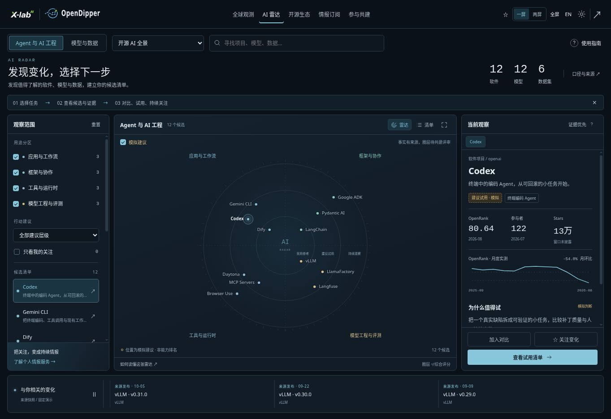

# AI radar implementation contract

Application **1.3.0**, 2026-10-26. Route: `#radar`. Maintainer-approved implementation of [proposal #26](https://github.com/X-lab2017/open-dipper/issues/26); publication receipts belong in that issue and the [execution plan](plans/ai-radar-implementation.md). The accepted [atlas baseline](../design/baselines/atlas-1.3.0.md) remains the composition reference.

## User outcome and scope

A developer or researcher can choose a task, discover sourced candidates, inspect evidence, compare up to three objects of the same kind, export a trial checklist and follow candidates locally. The page explains its purpose in the title, three-step guide and a reopenable usage guide. Two-screen mode adds task starters and the public/personal-service value proposition. It is a working review release, not an independently reviewed adoption guide or paid service.

| Lens | Four capability areas | Initial sourced coverage |
| --- | --- | --- |
| Agent & AI engineering | Apps/workflows; frameworks/orchestration; tools/runtimes; model engineering/evaluation | 12 software repositories |
| Models & data | Language/reasoning; multimodal/embodied; retrieval/embeddings; datasets/benchmarks | 12 concrete model versions and 6 datasets |

Task filters cover coding workflows, research agents and local model/data selection. They are AI-assisted taxonomy, not benchmark evidence. These 30 curated entities are a sample, not global totals. Model candidates concentrate on the supplied report sample; subsequent additions should improve task coverage and diversity.

## Facts, advice and change are separate

- `data/reference/radar/source-extract.json`: minimal factual extract, source identities, pinned Git commit/blob or API revision/response hash, original dates, metrics and AI-curated descriptions. No upstream artwork or application code is copied.
- `scripts/build-radar.mjs`: deterministic offline normalization. `npm run radar:build` generates the two runtime files; `npm run radar:check` detects drift and tests semantics. No retrieval timestamp changes on a build.
- `public/data/radar-catalog.json`: sourced facts only. Software OpenRank: 2026-08, 12-month series 2025-09–2026-08; participants: 2026-07. Model report downloads: trailing 30 days observed 2026-10-02. Current HF card revisions were retrieved on 2026-10-26. Report metrics cannot be attributed to a later revision. Unspecified metric periods remain null.
- `public/data/radar-demo.json`: fixed `2026-10-26T00:00:00Z` illustrative placements and action text, explicit `provenance: demo`. Default enabled for the approved demonstration release. The visible switch removes these judgments and leaves the observed catalog in list form. It never turns example advice into reviewed advice.
- Change strip: exact repository matches to existing collected release signals, plus visibly fixed demo verification tasks. It does not fabricate new releases, continually change their dates or claim a live collection backend.

Downloads do not equal users, quality or task success. OpenRank and ModelRank measure different ecosystem signals and are not pooled. Same-kind comparisons show each metric's own period, leave absent values unknown and do not compute an overall score. Performance, cost and independent adoption evidence are pending.

## Schema and behavior

`src/radar/model.ts` defines validated, bounded `Catalog`, `Entity`, `Metric`, `Source`, `Demo` and local-state types. Entities use platform/repository IDs or full HF slugs; source references must resolve, numeric values must be finite and nonnegative (or null), and evidence URLs allow only HTTP(S). Text is escaped by the view. Demo validation is independent: a missing/bad demo file leaves source facts usable; a missing/bad catalog offers retry while other routes remain available.

`src/radar/view.ts` owns rendering and action binding. `src/radar/radar.css` uses existing shared design variables in both themes. `src/atlas.ts` integrates the route and cleans up listeners/timers on navigation. No new runtime dependency is required.

The three rings are illustrative adoption reference, worth a trial and keep watching. Equal circular marks express no numerical score; exact angle and distance within a ring carry no ranking. Placement derives from the complete edition, so filters do not move remaining entities. Labels have separate collision spacing. Keyboard users can activate marks or the equivalent candidate list. Recent inspection tabs show one selected entity; source inspection is available in a modal.

Comparison accepts up to three candidates of the same entity kind. Changing lenses does not silently discard the comparison; remove old entries to compare another kind. Downloads retain source URLs, periods and demo labels. Trial checkboxes apply to the current view only. Browser-local watches are persisted and appear under `#following`.

`od:radar` stores validated lens, task, view, selected ID, watched IDs, demo preference, guide dismissal and pause preference. It is separate from `od:intelligence` and existing repository stars. No identity, cloud sync, delivery, payment or account access is activated. The OpenShare link is a resource-discovery link; it promises no candidate-specific entitlement or integration.

Expand radar opens an overlay with a visible return button and Escape. Global fullscreen and one/two-screen controls retain the shared behavior. Narrow layouts flow vertically. Change-strip movement pauses on hover, keyboard focus, hidden tabs, user pause or reduced-motion preference; it is not a real-time data refresh.

## Contributing the next facts

1. Add a concrete entity and authoritative source identity, preserve original statistical windows, record unavailable fields as null and disclose any AI-created description.
2. Add evidence appropriate to the entity: software task trials; model revision/hardware/task evaluations; dataset splits, contamination and suitability checks.
3. Run the builder and checks. Never promote a demo ring to a factual verdict. Reviewed assessments need a separate contract for reviewer, task, version, rationale and review date before enabling them.
4. Refresh manual extracts deliberately. Existing 30-minute event collection does not refresh this catalog. Automated HF / repository adapters and broader sources are follow-up work.

Source and reuse boundaries: [RIGHTS.md](RIGHTS.md). Agentic AI Landscape facts retain provenance but have no inferred blanket redistribution license. GOSD excerpts are attributed to X-lab2017 / GOSD / OpenGauge. HF license fields are upstream metadata, not newly granted rights or legal conclusions.

## Verification

- `npm run radar:check`: identity/source integrity, separate facts/demo clocks, missing data, filters, comparison limits, stable placement, exports and hostile local state.
- `npm run test:portal:ui`: portal regression plus `tests/radar-ui.mjs` for task/lens flows, comparisons/downloads, watches/reload, source/checklist dialogs, keyboard, overlay return, two screens, themes, English, mobile and independent file failures.
- Required release gates: `npm run typecheck`, `npm test`, `npm run build`, CI browser acceptance and actual Pages deployment. Successful compilation alone is not publication.

## Published review record

[PR #27](https://github.com/X-lab2017/open-dipper/pull/27) and [CI / Pages 40268988631](https://github.com/X-lab2017/open-dipper/actions/runs/40268988631) delivered this version. The image below was captured from the public `#radar` route on 2026-10-26. It shows sourced snapshots and separately labelled illustrative advice, not current statistics. It was captured by Codex through the managed browser and is retained as a deliberate product-review record rather than disposable CI output.

