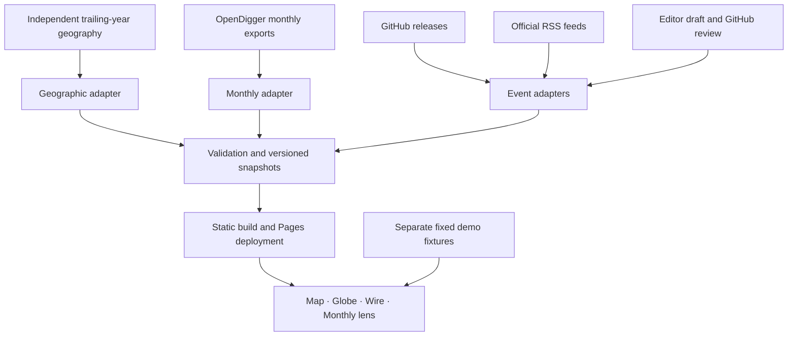

# OpenDipper v1 architecture

Maintained baseline: 2026-10-25. Start with [current status](STATUS.md); field-level definitions live in [the contract index](DATA_CONTRACTS.md).

## Product structure

The main task is to locate a signal, understand its scope and time, and inspect evidence. Map and globe are alternate projections of the same layers. The wire retains worldwide events without forcing coordinates. Analysis panels use independent monthly metrics. Desktop defaults to a one-screen layout; two-screen presentation expands analysis on a second screen while retaining the spatial view and wire on the first. Mobile flows naturally. The map is the initial view, with globe and wire as alternatives.

| Surface | Question | Data and interaction |
| --- | --- | --- |
| Overview | What is observable? | Sample coverage, actual event counts, snapshot time and scheduled cadence |
| Map/globe | Where is participation or influence distributed? | Real organization-label geography; synthetic global monthly demonstration |
| Layer rail | What am I looking at? | Scope, geographic metric, heat/marker/graticule switches, six categories |
| Event wire | What has been published? | Time/category/region/priority/text filters and original sources |
| Monthly lens | How did this metric change? | Same-platform sample ranking, calendar-month bars, watchlist |
| Evidence | Can I verify it? | Source URL, metric period, retrieval time, checksum and status |
| Editorial intake | How does an editor add an event? | Local draft → issue → maintainer approval → feed |

## Data paths

Public feeds are fetched in GitHub Actions, normalized into JSON and published with the static app. No public write API or client credentials. This supports review-scale feed volume without a hosted database; it does not claim streaming or a hard thirty-minute guarantee.

## Modules

| Module | Responsibility |
| --- | --- |
| `src/observatory/model.ts` | Contracts, validation, time filters, ranking, missing-value semantics |
| `src/observatory/scene.ts` | Geographic projection/clipping, choropleth, markers, camera/keyboard |
| `src/observatory/main.ts` | Product state, panels, dialogs, editor, polling |
| `src/observatory/style.css` | Product layout, one/two screens, responsive behavior, reduced motion |
| `src/observatory/globe-math.ts` | Camera tween/inertia helpers and Mercator coordinate/zoom math |
| `design/tokens.json`, `src/design/` | Shared semantic tokens, generated CSS/Canvas palette, components and showcase |
| `src/main.ts`, `src/panorama.ts` | Tested analysis and previous panorama compatibility routes |
| `scripts/fetch-data.mjs` | Configurable monthly repository adapter and provenance |
| `scripts/refresh-monthly.mjs` | Last-good retention after transient upstream failures |
| `scripts/fetch-geography.py` | Geographic label aggregates, known anchors, geometry |
| `scripts/collect-events.py` | Release/RSS/editorial adapters, stable IDs, retention, source health |
| `config/` | Repository catalog and approved endpoints |
| `public/data/` | Versioned observed snapshots and separate synthetic fixtures |
| `docs/CONTEXT.json`, `scripts/build-context.mjs` | Human/Agent discovery index and generated public mirrors |
| `scripts/check-docs.mjs` | Offline local-link and context recipe validation |

## Temporal model

1. Each repository metric has its own `latestMonth` and actual observations. Retrieval time is not an observation watermark.
2. Real geography is a trailing-year aggregate with unpublished exact endpoints and unknown-country denominator. It is not interpolated into monthly observations.
3. Events have source publication time (`occurredAt`), first retrieval (`collectedAt`), plus per-source last attempt/success.
4. Demo dates are fixed. A redeployment never makes them fresh.

## Ingestion behavior

- Maintainers configure source endpoints; site visitors cannot trigger arbitrary URL fetching.
- Ten release records per repository and forty RSS entries per response; 4 MB response and twenty-second request limits. Ninety-day retention and 2,000-record cap. These are review limits, not exhaustive coverage.
- Stable source-URL hashes or issue IDs deduplicate events. Content updates preserve first collection time.
- Missing timestamps are rejected. Failures retain previous records and show stale/error. Successful editorial refreshes authoritatively reconcile withdrawals.
- Label approval is compared to the issue's latest update. Changes require reapproval. Missing history or API failure cannot bypass this gate.
- Summaries are plain text, UI output is escaped and source links are HTTP(S).
- Observed data never silently falls back to simulation.

## Connecting full-coverage data next

1. **Monthly regional aggregates:** supply month, metric definition, raw region code/display group, value or explicit absence, coverage denominator, unknown-region count, source version and provenance. Introduce this as a separate monthly geography adapter, not by renaming trailing-year label metadata.
2. **Broader repository catalog:** extend `config/repositories.json`; use preaggregated partitions/pagination beyond browser-friendly size. Keep each ranking to one platform and common month.
3. **Organizations/technology groups:** ingest explicit memberships and effective dates. Do not sum overlapping groups as independent populations.
4. **Event sources:** add project/foundation announcements, verified security advisories, policies and calendars. Preserve original time, scope and provenance. RSS topic classification is not a confirmed incident diagnosis.
5. **Geographic/entity links:** editors can supply locations today. Automated extraction needs confidence and evidence before placing a point. Project domicile and event geography are distinct.

At higher volume, move adapters to a worker queue and durable database/object storage, publish versioned API snapshots and retain frontend contracts. Add authenticated editorial roles at that stage; do not expose an unauthenticated publish endpoint on this static site.

## Operational boundaries

- Thirty minutes is a collection target. Source cadence, Actions queues, builds and Pages caches add latency.
- Taiwan is displayed as part of China; source identifiers and measurements remain unchanged.
- Markers represent region anchors or documented event locations, never individual tracking. No collaboration arcs are inferred from unrelated totals.
- Watchlists/drafts are browser-local, not a multi-user backend.
- Git provides history and rollback; `panorama.html` and `analysis.html` retain previous interfaces.

## Collaboration and change boundaries

Read [AGENTS.md](../AGENTS.md) or [CONTRIBUTING.md](../CONTRIBUTING.md), then the task-specific [development guide](DEVELOPMENT.md). [Decisions](DECISIONS.md) explain reference identity, rendering, time semantics and display modes. [Operations](OPERATIONS.md) owns schedules/rollback; [maintenance](MAINTENANCE.md) owns generated artifacts and compatibility retention. Public discovery endpoints are static indexes, not an API or authorization mechanism.
