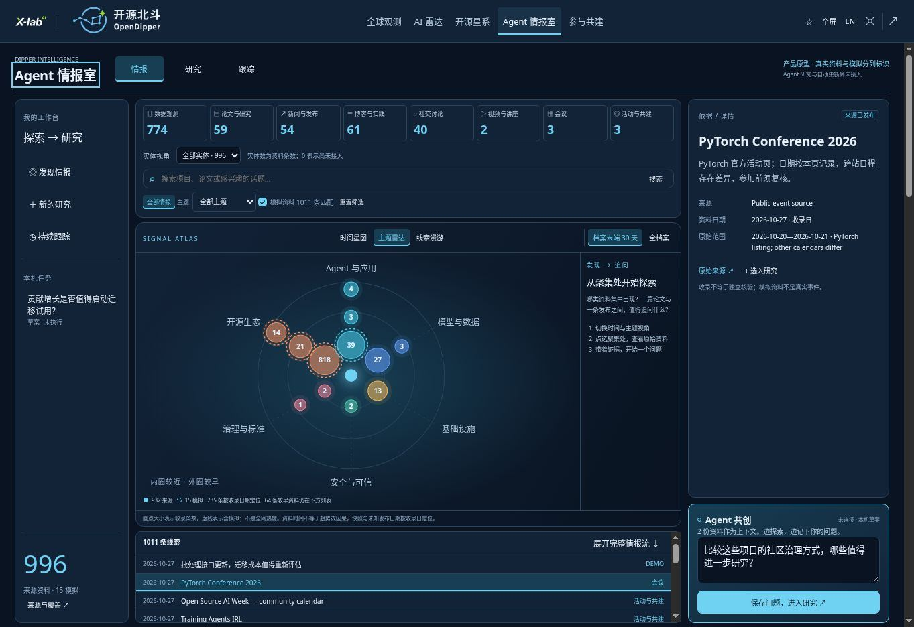
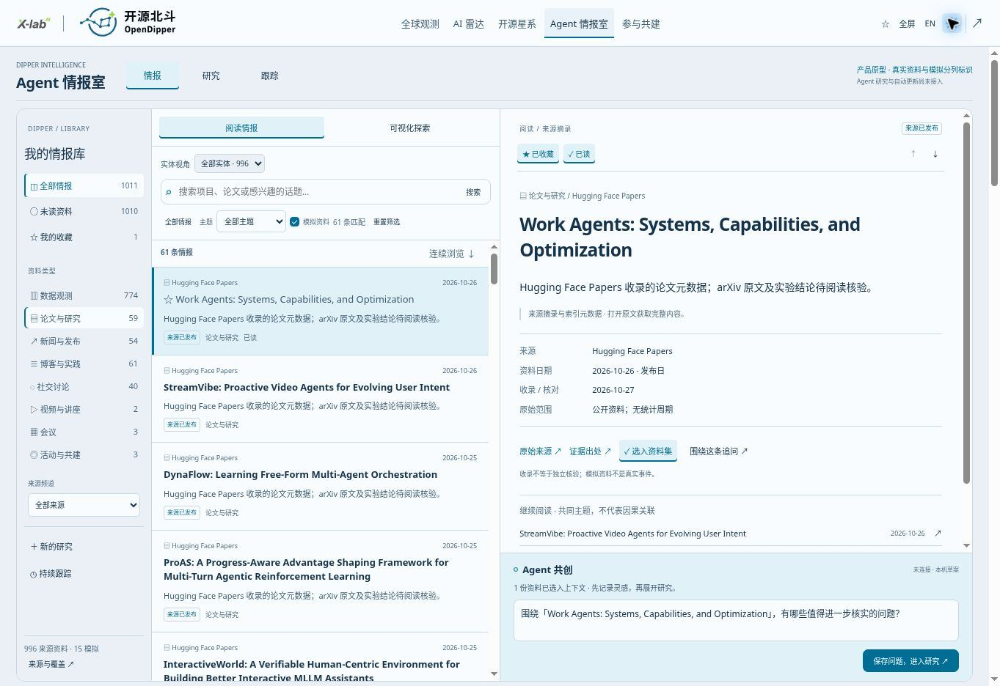

# AI + 开源情报库 / AI + open-source intelligence library

Current homepage: **1.11.0 focused reader** (final section below). Earlier 1.7–1.10 layout descriptions and screenshots are historical design context; they do not describe the current Intelligence tab. Source contracts remain applicable.
Application 1.9.0, 2026-10-27. Public browsing and local research prototype; not an autonomous research service. Implementation: `src/intelligence-room/`; data: `public/data/intelligence-catalog.json`.

## Visual discovery · 1.8.0

Three original visual lenses sit between the category summary and searchable stream. **Timeline** facets the same records by form across 14 chronological buckets; **Topic radar** places six primary topics into three equal temporal bands (inner is more recent); **Story walk** provides six manual topic stops, with up to three distinct material forms and an open research question. It is a thematic browsing aid, not an automatically generated news narrative or a claim that records describe the same event.

Selecting a bubble filters the feed to those exact records. A research starter brings up to 30 selected records and an editable question into the existing local draft. Reset clears graphical selection. Category/search/date/demo filters scope all lenses. The default visual window is the last 30 days of the loaded matching archive; all-time is available, and earlier records remain in the stream unless a cluster is selected. No current-day or live coverage claim. Form or primary-topic grouping assigns each record once; multi-topic tags still work in the regular topic filter.

Bubble size represents indexed volume (capped for legibility), not popularity, quality, influence or causality. Solid fill means source records are present; dashed outlines mark included demos, with separate totals. Data snapshots and unknown publication dates use capture date on the chart and remain labelled; original observation periods remain in detail views. Empty scopes produce empty states. All chart cells are keyboard-operable, support focus, light/dark themes, and reduced motion. No timer or autoplay.

Design references inspected 2026-10-27: [Timeline Storyteller](https://github.com/microsoft/timelinestoryteller), especially faceted timelines / radial representation / scene navigation; [AI News Radar](https://github.com/LearnPrompt/ai-news-radar), especially simple category navigation and source-preserving thematic browsing. Timeline Storyteller is archived; its D3 3 / Webpack 2 code is not embedded. No upstream code, icons, generated commentary, ranking scores, feed data or Agent skills were copied or installed. This release does not introduce semantic same-event clustering, AI-generated recommendations or new collection services.

## 阅读与分类

入口先呈现八类资料汇总，再提供主题、搜索、时间筛选与连续下拉的资料流。每次展示 36 条，接近底部继续加载；键盘用户也可以点击“继续翻阅”。到达本次资料集末尾明确停止，不生成填充内容。

| 资料形态 / Form | 内容与边界 |
| --- | --- |
| 数据观测 / Data | 全球观测汇总、160 个雷达候选，以及开源星系中 AI / Agent / 云原生前 50 个 OpenRank 节点的去重摘录；不是完整全球知识库 |
| 论文 / Papers | arXiv 原文链接；精选元数据以及 Hugging Face Papers 索引，不镜像论文全文，也不声称已复现实验 |
| 新闻 / News | 原有已采集快讯与发布；继续保留其独立审核制度 |
| 博客 / Blogs | Hugging Face 公开博客元数据；原文阅读，不复制完整文章 |
| 社交 / Social | Hacker News 公开讨论标题和讨论链接；不是 X/微信等平台全量采集，也不背书帖子观点 |
| 视频 / Video | 两条公开搜索索引取得的视频标题与链接；播放、字幕、作者身份与内容未独立核验，未镜像媒体 |
| 会议 / Conferences | 全球观测已有会议与 PyTorch 官方活动页；日期冲突显式保留，不能替代主办方最终日程 |
| 活动 / Events | 社区演示、Agent 交流活动与 Open Source AI Week 日历；不是代用户报名 |

六个交叉主题：Agent 与应用、模型与数据、基础设施、安全与可信、治理与标准、开源生态。主题由显式编辑标签或标题关键词规则生成，属于检索辅助，不是质量评分。来源包含开放技术讨论，不代表其中每个模型、项目或资料具有相同开源许可。

卡片和各类统计分开标识来源与模拟。全档案默认包含历史论文；日期区间筛选不把旧文包装成最新资讯。未知发布日期使用明确标识的收录日期。会议举办日期、统计观测期、发布日期、收录日期分别保留。固定 2026 年 10 月透镜继续支持“看变化 / 看当时”；任意日期输入用于全档案范围筛选。这里不是完整历史重建或所有来源的版本档案。

## Ontology-inspired evidence foundation

Reference: [Palantir Ontology overview](https://www.palantir.com/docs/foundry/ontology/overview), consulted 2026-10-27. Palantir documents objects, properties, links and operational actions/security. OpenDipper currently implements only a small read-oriented evidence index; no Palantir code, integration or functional equivalence is claimed.

| Concept | Current implementation | Later extension |
| --- | --- | --- |
| Entity | Canonical URL identity for projects, models and datasets | Source-qualified organizations, conferences, research works; identity resolution with disputes |
| Material | Stable ID, form, topic, source URL, optional evidence URL, publication/capture clock, original period | Versioned excerpts, lawful transcripts, document figures and media segments |
| Link | `describes` / `references`, exact entity URL, evidence URL, `source-recorded`; browse associated materials | Separately marked inferred links, supporting/contradicting claims and reviewed corrections |
| Action | Select sources, save local research draft, follow locally, export | Bounded server-side runs, explicit permissions, reviewable operations and delivery consent |
| History | Original capture dates retained, report versions demonstrated separately | Evidence revisions, retractions, entity validity periods and reproducible queries |

No relationships are inferred from geographic co-location, similar names or keyword overlap. The starfield’s network edges are not copied into this index as organizational partnerships. A source-recorded link means the source record names that object, not that its claims are true.

## Collection and reproducibility

- `scripts/collect-intelligence.py`: four fixed public endpoints (HF blogs, HF Papers, arXiv query, HN search). At most one request/source per six hours, 18-second timeout, 1.5 MB response bound, 80 retained records/source; no credentials, arbitrary remote URL traversal, full articles, private posts, media downloads or account sessions.
- `data/reference/intelligence/collected.json`: actual bounded results and source health. Initial arXiv API returned HTTP 429; the failed state is retained. Separately labelled HF Papers metadata and curated arXiv links do not pretend that direct arXiv collection succeeded.
- `data/reference/intelligence/curated.json`: selected source metadata. Videos are `search-metadata`, papers obtained through HF are `aggregator-metadata`; provenance does not imply manual factual approval.
- `scripts/build-intelligence.py`: deterministic assembly from retained input records, pinned radar/galaxy/observatory files; canonical URL deduplication, entity records and evidence links. Radar and galaxy observation windows are not replaced with build dates.
- `npm run refresh:intelligence` collects then builds. Run it explicitly for a new reviewed snapshot; it is not wired into scheduled Actions. The six-hour TTL bounds repeated requests. Failures retain last-good records and update the visible source status. Static pages only change after a successful deployment; no live-stream SLA.
- `npm run intelligence:check` checks reproducibility, unsafe links, dangling entities, filtering and collector failure retention. Browser acceptance covers the optional catalog failure path independently from the existing atlas startup boundary.
- A missing or invalid optional catalog leaves base observations and events usable and offers retry; it never enables demo data automatically.

Initial expanded file: 354 source records; base global facts and existing news are combined/deduplicated at runtime. Counts change with collection, date filters and source retention; the live visible category counts are authoritative for the loaded snapshot. Fifteen fixed fictional materials are independent of collectors. No invented citations, views, engagement or confidence scores.

## Rights and next review

Preserve upstream attribution and existing per-dataset rights. Store source identifiers/titles, limited metadata and independently written index notes; no redistribution permission for papers, media, logos or full articles is implied. External sources are untrusted evidence, never operational instructions.

Review whether broad browsing leads to useful research questions, whether category boundaries are understandable, and whether source/context transfer is sufficient. Next implementation gate is a real evidence-backed research pilot, not more decorative graph effects. Payments, private institutional data and external deliveries require their own design and authorization.

## Workbench expansion · 2026-10-27 review

The 1.9.0 layout (superseded by the reading-first layout below) occupies one viewport: local tasks on the left, form and entity facets above the three visual lenses, matching records below the chart, evidence detail and an Agent draft composer on the right. The second screen retains the full progressive stream. Chart/form/entity/search filters intersect; selection and draft text survive lens changes. Record clicks open inline evidence, including source-qualified object links. The composer persists a local question and can create a research draft; it does not send a message to an AI service or fabricate responses.

The additional retained snapshot `data/reference/intelligence/expanded.json` contains **591 distinct source-qualified records**. Its new online collection includes 380 Apache project profiles and 133 distinct public PMC chairs (first 140 committees in the returned official ordering, deduplicated by account), three inspected patent publications, and three official directory/governance pages. The rest adapts existing observatory evidence. Merged with the previous catalog, URL deduplication yields **940 catalog records**; base observations and current event feeds add further records at runtime. Fifteen fixed demos remain separate. This is a deliberately Apache-heavy review sample, not a statistically representative global census or 940 new news events.

The Apache registry was fetched manually on 2026-10-27 from `https://projects.apache.org/json/foundation/projects.json` and `https://projects.apache.org/json/foundation/committees.json`, with an 18–25 second timeout and 2 MB response bound. SHA-256 response hashes are retained in the snapshot. Only project names, categories, implementation languages and public chair names/accounts/roles were retained; no email addresses, private contact information or inferred personal geography. Dormant/retired source labels remain visible. This import is not scheduled; ordinary builds only assemble retained input. Existing four-source refresh and its failure retention are unchanged.

Patent references: US20200057858A1 (2020-02-20), US20250200179A1 (2025-06-19), CN111061864A (2020-04-24), inspected via their Google Patents publication pages. Metadata only; no assertion of legal status, grant, validity, license or freedom to operate. A patent mentioning open source is not itself an open-source license.

Entity facets include people, projects, organizations, foundations, universities, models, datasets, patents, compute, energy, conferences, events, mirrors, governance/standards, content/application directories and regional observations. Counts mean **indexed records about a type**, not unique worldwide objects. The 18 observatory layers map to people/region (developers, contribution, talent), organizations/foundations/universities, projects/region (influence, benchmark, emerging), models/datasets/code/content, compute/energy and news/meetings. The original content-region statistics remain unavailable: the application-directory entry does not fill that geographic gap. Existing report identities and source qualifiers are preserved; records sharing a report URL use a local fragment identifier and a separate exact evidence URL. No invented coordinates, totals or inferred relationships.

## Reading-first homepage · 1.10.0 review

The default first screen is a source/form navigation rail, compact chronological list and evidence reader with a persistent local question composer. Visual exploration is an explicit alternate mode; the second-screen stream remains available and shares filters. Read mode is not narrowed by a hidden chart selection. Source/channel, entity, type, topic, search, time and saved/unread filters intersect. Counts in the collection rail are library-wide (respecting the demo toggle); list counts are current matches. Dates keep publication/capture/snapshot distinctions.

Saved and explicitly marked-read IDs persist locally in `od:reader-v1`, bounded to 2,000 each. Opening a preview does not imply it has been read. No account sync or external service is used. “Ask about this” adds the exact record to the source bundle and fills a question only when the draft is empty; existing writing is retained. Saving creates an unexecuted research draft with those IDs. Related-reading links use existing shared topic tags, never inferred causal edges. The reader presents retained excerpts/metadata, not scraped full articles or generated summaries; videos open at their original source.

Product references, inspected 2026-10-27: [Folo](https://github.com/RSSNext/Folo) for reading/navigation/contextual questioning; [Open Notebook](https://github.com/lfnovo/open-notebook) for source bundles; [DeerFlow](https://github.com/bytedance/deer-flow) for distinguishing tasks from results; [Khoj](https://github.com/khoj-ai/khoj) for following; [OpenCTI](https://github.com/OpenCTI-Platform/opencti) for evidence-bearing entity context. These are interaction references, not connected services. No upstream source code, assets, dependencies or license terms are imported. Existing local research and fictional report/version boundaries remain unchanged.

## Focused reader · 1.11.0 (supersedes the 1.10 homepage)

Intelligence is now exclusively a three-pane reader. Visual discovery, duplicate card stream, local task rail, Agent composer and legacy service/sample panels are removed from this tab. Actual source records remain accessible through incremental list loading; fictional fixtures are excluded from reading and retained only for explicit research examples. Type/source navigation, saved/unread, search, optional entity/topic/date filters, previous/next, original links and expandable evidence details remain. Mobile opens a dedicated reader with a return-to-list control. Research explicitly imports up to 30 saved sources; question entry stays there. Existing saved/read IDs and research drafts are retained.

Folo integration boundary: its inspected [root package](https://github.com/RSSNext/Folo/blob/dev/package.json) describes a private monorepo with separate application builds and AGPL-3.0-only metadata. The inspected README/package does not establish a supported embeddable reader component. This implementation borrows interaction patterns only; it is not a Folo client, iframe, SDK integration or account connection. Future source-level adoption needs an explicit runtime/data adapter and license decision. Current sources keep their own IDs, URLs, clocks and provenance. No upstream code/assets or full-article scraping are introduced.
