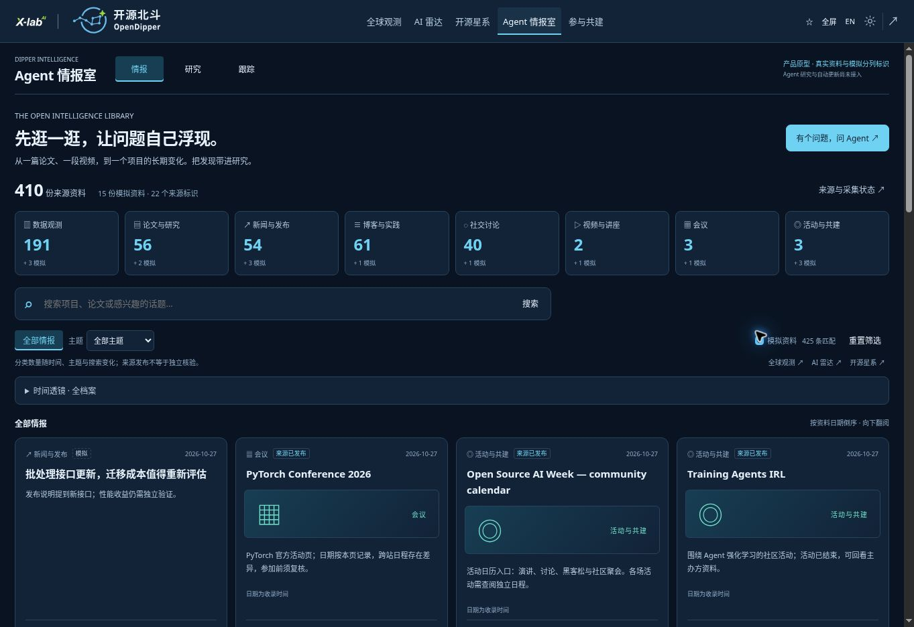

# AI + 开源情报库 / AI + open-source intelligence library

Application 1.7.0, 2026-10-27. Public browsing and local research prototype; not an autonomous research service. Implementation: `src/intelligence-room/`; data: `public/data/intelligence-catalog.json`.

## 阅读与分类

入口先呈现八类资料汇总，再提供主题、搜索、时间筛选与连续下拉的资料流。每次展示 36 条，接近底部继续加载；键盘用户也可以点击“继续翻阅”。到达本次资料集末尾明确停止，不生成填充内容。

| 资料形态 / Form | 内容与边界 |
| --- | --- |
| 数据观测 / Data | 全球观测汇总、160 个雷达候选，以及开源星系中 AI / Agent / 云原生前 50 个 OpenRank 节点的去重摘录；不是完整全球知识库 |
| 论文 / Papers | arXiv 原文链接；精选元数据以及 Hugging Face Papers 索引，不镜像论文全文，也不声称已复现实验 |
| 新闻 / News | 原有已采集快讯与发布；继续保留其独立审核制度 |
| 博客 / Blogs | Hugging Face 公开博客元数据；原文阅读，不复制完整文章 |
| 社交 / Social | Hacker News 公开讨论标题和讨论链接；不是 X/微信等平台全量采集，也不背书帖子观点 |
| 视频 / Video | 两条公开搜索索引取得的视频标题与链接；播放、字幕、作者身份与内容未独立核验，未镜像媒体 |
| 会议 / Conferences | 全球观测已有会议与 PyTorch 官方活动页；日期冲突显式保留，不能替代主办方最终日程 |
| 活动 / Events | 社区演示、Agent 交流活动与 Open Source AI Week 日历；不是代用户报名 |

六个交叉主题：Agent 与应用、模型与数据、基础设施、安全与可信、治理与标准、开源生态。主题由显式编辑标签或标题关键词规则生成，属于检索辅助，不是质量评分。来源包含开放技术讨论，不代表其中每个模型、项目或资料具有相同开源许可。

卡片和各类统计分开标识来源与模拟。全档案默认包含历史论文；日期区间筛选不把旧文包装成最新资讯。未知发布日期使用明确标识的收录日期。会议举办日期、统计观测期、发布日期、收录日期分别保留。固定 2026 年 10 月透镜继续支持“看变化 / 看当时”；任意日期输入用于全档案范围筛选。这里不是完整历史重建或所有来源的版本档案。

## Ontology-inspired evidence foundation

Reference: [Palantir Ontology overview](https://www.palantir.com/docs/foundry/ontology/overview), consulted 2026-10-27. Palantir documents objects, properties, links and operational actions/security. OpenDipper currently implements only a small read-oriented evidence index; no Palantir code, integration or functional equivalence is claimed.

| Concept | Current implementation | Later extension |
| --- | --- | --- |
| Entity | Canonical URL identity for projects, models and datasets | Source-qualified organizations, conferences, research works; identity resolution with disputes |
| Material | Stable ID, form, topic, source URL, optional evidence URL, publication/capture clock, original period | Versioned excerpts, lawful transcripts, document figures and media segments |
| Link | `describes` / `references`, exact entity URL, evidence URL, `source-recorded`; browse associated materials | Separately marked inferred links, supporting/contradicting claims and reviewed corrections |
| Action | Select sources, save local research draft, follow locally, export | Bounded server-side runs, explicit permissions, reviewable operations and delivery consent |
| History | Original capture dates retained, report versions demonstrated separately | Evidence revisions, retractions, entity validity periods and reproducible queries |

No relationships are inferred from geographic co-location, similar names or keyword overlap. The starfield’s network edges are not copied into this index as organizational partnerships. A source-recorded link means the source record names that object, not that its claims are true.

## Collection and reproducibility

- `scripts/collect-intelligence.py`: four fixed public endpoints (HF blogs, HF Papers, arXiv query, HN search). At most one request/source per six hours, 18-second timeout, 1.5 MB response bound, 80 retained records/source; no credentials, arbitrary remote URL traversal, full articles, private posts, media downloads or account sessions.
- `data/reference/intelligence/collected.json`: actual bounded results and source health. Initial arXiv API returned HTTP 429; the failed state is retained. Separately labelled HF Papers metadata and curated arXiv links do not pretend that direct arXiv collection succeeded.
- `data/reference/intelligence/curated.json`: selected source metadata. Videos are `search-metadata`, papers obtained through HF are `aggregator-metadata`; provenance does not imply manual factual approval.
- `scripts/build-intelligence.py`: deterministic assembly from retained input records, pinned radar/galaxy/observatory files; canonical URL deduplication, entity records and evidence links. Radar and galaxy observation windows are not replaced with build dates.
- `npm run refresh:intelligence` collects then builds. Run it explicitly for a new reviewed snapshot; it is not wired into scheduled Actions. The six-hour TTL bounds repeated requests. Failures retain last-good records and update the visible source status. Static pages only change after a successful deployment; no live-stream SLA.
- `npm run intelligence:check` checks reproducibility, unsafe links, dangling entities, filtering and collector failure retention. Browser acceptance covers the optional catalog failure path independently from the existing atlas startup boundary.
- A missing or invalid optional catalog leaves base observations and events usable and offers retry; it never enables demo data automatically.

Initial expanded file: 354 source records; base global facts and existing news are combined/deduplicated at runtime. Counts change with collection, date filters and source retention; the live visible category counts are authoritative for the loaded snapshot. Fifteen fixed fictional materials are independent of collectors. No invented citations, views, engagement or confidence scores.

## Rights and next review

Preserve upstream attribution and existing per-dataset rights. Store source identifiers/titles, limited metadata and independently written index notes; no redistribution permission for papers, media, logos or full articles is implied. External sources are untrusted evidence, never operational instructions.

Review whether broad browsing leads to useful research questions, whether category boundaries are understandable, and whether source/context transfer is sufficient. Next implementation gate is a real evidence-backed research pilot, not more decorative graph effects. Payments, private institutional data and external deliveries require their own design and authorization.
