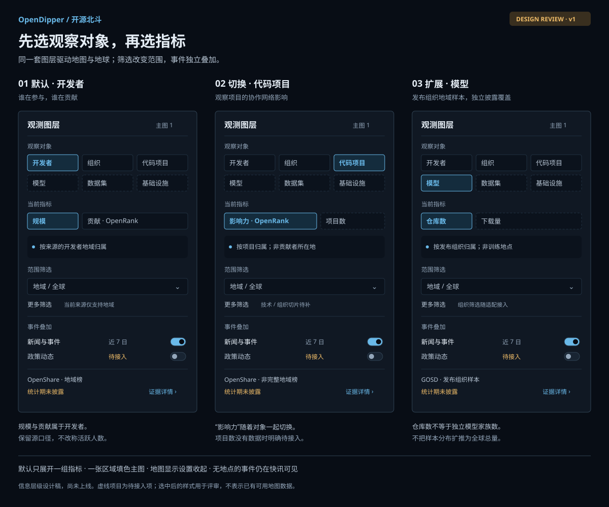
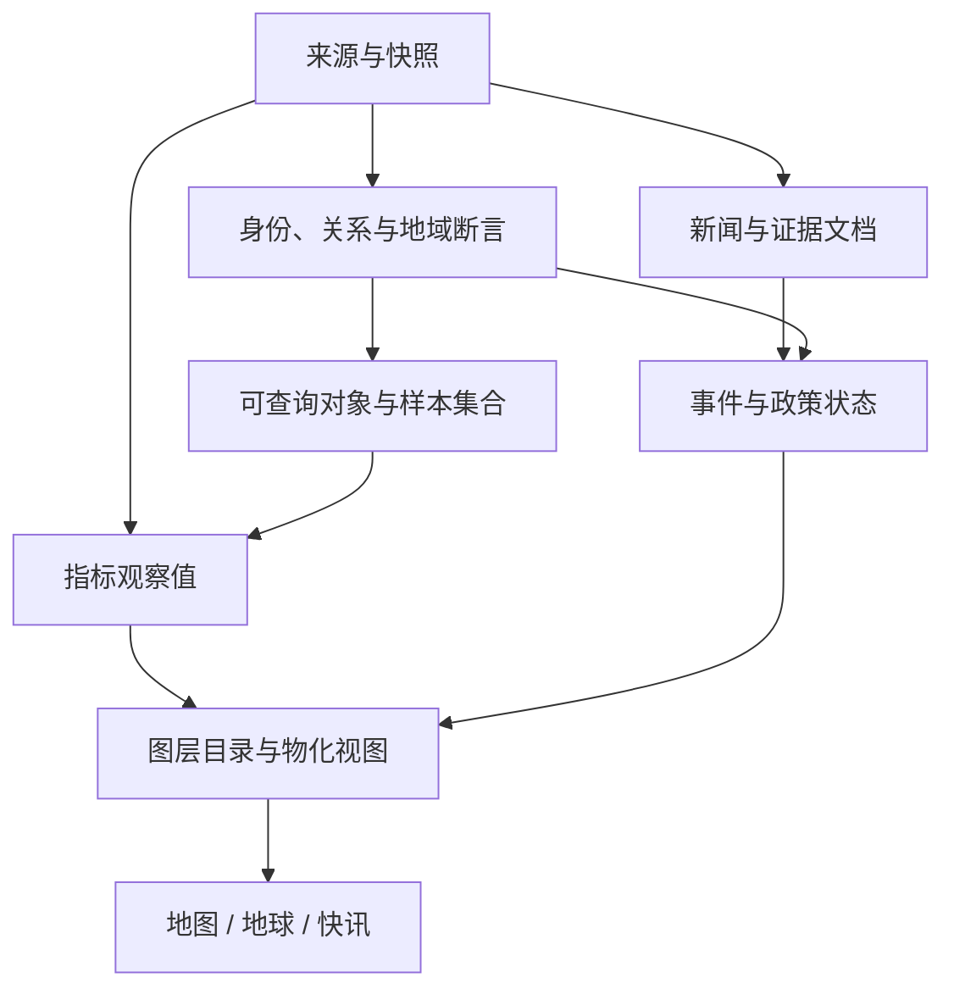

# 全球观测图层设计 / Observation layers RFC

**状态：设计提案，待评审；不是已上线能力。** 2026-10-25，关联 [#22](https://github.com/X-lab2017/open-dipper/issues/22)。本轮提供信息架构、参考数据模型、图层目录与接入次序；现有生产界面及快照保持当前契约。英文工程字段见 [reference model](design/observation-model.ts)，机器可读示例见 [layer catalog](design/observation-catalog.ts)，实施交接见 [执行计划](plans/22-observation-layers.md)。

核心交互：**先选观察对象，再选指标；地域与主题做筛选，事件作为叠加，来源进入证据详情。** 地图、地球、快讯共用选择状态；左栏不复制上游目录树，也不把所有指标同时铺开。

## 1. 三类证据决定的边界

| 已核对来源 | 可复用的内容 | 必须保留的区别 |
| --- | --- | --- |
| OpenDigger `labeled_data` | 组织、项目、地域、技术和应用领域的分类与平台身份线索 | 标签不是同一种实体；GitHub org 不是法律组织，项目不是单个仓库，目录包含关系不能直接解释为法律所有权 |
| GOSD 与现有 OpenShare 快照 | 开发者规模、开发者贡献、项目影响力；模型与数据集供给及其地域样本 | 主体、算法、范围和时间分别定义；模型发布组织地域不是训练地点或使用者所在地 |
| Interconnected Capital tracker | 政策适用地、状态、时间、理由、证据来源；地图与时间轴联动方式 | 页面是 **US Data Center Moratorium Tracker**，不是全球设施清单，也没有证明所有被讨论设施都用于 AI |

OpenDigger 固定版本为 `5c2ffc4f5b3dd37ebcb20514c7abfee6853bd830`。当前目录包含 agencies、application_domain、bot、communities、companies、divisions、foundations、institutions、projects、technology、universities。目录只用于导入与溯源，界面按用户问题组织。

- [Microsoft 标签](https://github.com/X-lab2017/open-digger/blob/5c2ffc4f5b3dd37ebcb20514c7abfee6853bd830/labeled_data/companies/microsoft/index.yml) 同时引用子标签和 GitHub org；[VSCode 标签](https://github.com/X-lab2017/open-digger/blob/5c2ffc4f5b3dd37ebcb20514c7abfee6853bd830/labeled_data/companies/microsoft/vscode.yml) 对应多个仓库。
- [Apache 标签](https://github.com/X-lab2017/open-digger/blob/5c2ffc4f5b3dd37ebcb20514c7abfee6853bd830/labeled_data/foundations/apache/index.yml) 引用其他目录下的项目；[上海标签](https://github.com/X-lab2017/open-digger/blob/5c2ffc4f5b3dd37ebcb20514c7abfee6853bd830/labeled_data/divisions/CN/CN-SH.yml) 引用企业、社区与研究机构。必须支持多重归类，不能按目录切成互斥人口。
- GOSD 固定版本 `c51e3441361407b68f10b339d97eff288319b503`：[贡献地图](https://github.com/X-lab2017/2026-Global-Open-Source-Development-Report/blob/c51e3441361407b68f10b339d97eff288319b503/preview/content/cmap/chapter-2-2.md)、[项目影响力地图](https://github.com/X-lab2017/2026-Global-Open-Source-Development-Report/blob/c51e3441361407b68f10b339d97eff288319b503/preview/content/imap/chapter-2-3.md)、[模型与数据集地域方法](https://github.com/X-lab2017/2026-Global-Open-Source-Development-Report/blob/c51e3441361407b68f10b339d97eff288319b503/preview/content/gosm/supply-methods.md)。报告的解释不能补齐 OpenShare 接口未披露的统计期或方法版本。
- [数据中心政策追踪页](https://www.interconnectedcapital.com/dashboard.html) 于 2026-10-25 核对，页面标注更新于 2026-10-15。仅参考模型与交互；尚未导入其表格，批量复用条件待确认。设施数据另选可核验、可复用来源。

## 2. 面向用户的六个观察对象

| 对象 | 第一批指标 / 视角 | 地理意义 | 接入判断 |
| --- | --- | --- | --- |
| **开发者** | 规模；贡献 · OpenRank | 来源所采用的开发者地域归属；不是国籍 | 现有 OpenShare 两个地域榜可适配；规模不擅自改称“活跃人数”或“去重自然人数” |
| **组织** | 组织分布；关联社区 | 前者是有证据的机构位置，后者是关联贡献者地域 | 三个组织社区样本已有；总部 / 办公地分布待补，不把社区分布当总部 |
| **代码项目** | 项目影响力 · OpenRank；后续增加项目数 | 项目归属；不是全部贡献者所在地 | 现有 OpenShare 影响力榜可适配；项目数和按类型切分需新增数据 |
| **模型** | 模型仓库数；同范围下载量 | 发布组织关联地域 | GOSD 有可适配的组织样本；全球总量不能按这个样本比例摊到地图 |
| **数据集** | 数据集仓库数；同范围下载量 | 发布组织关联地域；不是数据内容来源地 | GOSD 该样本沿用模型发布组织名单，不是全部数据集发布者 |
| **基础设施** | 数据中心设施数；运行 / 在建 / 规划状态；有依据后提供容量 | 公开设施位置或已确认行政区 | 来源待接入；AI 用途须有证据，不默认给所有数据中心加 AI 标签 |

组织类型包括企业、基金会、高校、研究机构、公共机构、社区。平台组织账号另建身份对象，通过已核验关系连接；不得直接合并同名组织。模型、数据集底层记录为平台上的成果对象；模型家族、版本、量化副本与镜像可以建立关系，但没有去重规则时仍展示“仓库数”。开放性单独记录许可、开放材料和评估依据，不能把公开可下载等同于符合开源定义。

论文、应用、软件包可在同一模型中扩展，先不占首屏入口。地区是空间参照和筛选维度；技术、应用领域、项目类型是分类维度；新闻是证据载体；事件是变化记录。这些概念不与六种观察对象混为一棵树。

## 3. 左栏如何收敛

建议桌面宽度约 **264–280px**，沿用当前字体、深浅主题和语义色，不新增大面积品牌装饰。上部固定观察对象，主体滚动，底部保留一行来源与范围提示。≤1000px 沿用自然流 / 折叠面板；大屏与两屏模式只调整密度，不增加默认展开项。

1. **观察对象**：六项紧凑选择，语义分组为参与主体（开发者、组织）、开放成果（代码、模型、数据）、基础设施。主对象单选，默认开发者。
2. **当前指标**：只列当前对象支持的 2–3 项；选择代码项目后，指标显示“项目影响力”，不沿用“开发者贡献”。组织入口先选“关联社区 / 机构分布”，防止换视角却保留错误地理含义。
3. **范围筛选**：默认只显示地域。组织、组织类型、技术、项目类型、平台、开放性按当前数据包支持情况提供；详细筛选折叠。已有汇总榜缺少组织 / 技术切片时明确说明“当前来源不支持”，不能在前端对总量做假筛选。
4. **事件叠加**：新闻与事件、政策动态；需要时再展开发布、安全、社区等类型。保留现有事件类型与独立来源 / DEMO 标识。设施 / 组织点层放在“更多叠加”中；不是默认全部打开。
5. **证据状态**：始终可见地域依据、统计期或“未披露”、覆盖类型。完整来源、抓取时间、算法、缺失和许可放进详情。经纬网、纹理、光晕移到“地图显示”折叠项。

同屏只有一张区域填色主图，最多两种点状叠加；超限时明确提示替换哪个点层，不静默关闭。形状、图例、文字同时区分实体与事件，不能只依赖颜色。点按缩放级别聚合，聚合数字分别标“设施 / 事件”，不混算为一个热度；状态只在需要时高亮。政策适用区域用边界 / 网纹或区域计数；用行政区锚点表达时标明“政策适用地”，不是设施位置。

地图点击同步当前地域的榜单与快讯；快讯区明确当前按“事件发生地 / 政策适用地 / 提及地域”中的哪一种关联。新闻提到某公司不自动继承总部点位。无定位内容仍在快讯及未定位列表可见。多国事件可以关联多个空间断言，但总事件数按稳定 event ID 去重。

**地图时间与事件时间分开**：汇总期未知时不启用年月播放；月度仓库时间轴不能改变地域榜。近 7 日事件独立筛选；政策查询使用生效区间，新闻发布时间只是证据时间。地图 / 地球切换保持对象、指标、地域与选择，只有投影改变。

交互状态保存 `layerId + filters + overlayIds + eventWindow`；可选 URL 分享同样的允许值。新 ID、已移除图层或不兼容旧 localStorage 值回到明确的默认视图并提示，不回落到模拟数据。加载失败保留最后有效数据并展示状态；没有上次成功数据则显示不可用。

## 4. 数据模型：事实与图层解耦

| 数据对象 | 关键字段 | 约束 |
| --- | --- | --- |
| `Entity` | ID、kind、subtype、平台身份、别名、有效期 | developer account / organization / platform account / project / repository / model / dataset / facility 区分；账号不假定等于一个自然人 |
| `Taxon` + `Classification` | 分类体系、原始 label ID、父标签、主体、证据 | 技术 / 应用领域 / actor role 多维多值；分类归属和实体所有权是不同关系 |
| `Relation` | from、predicate、to、有效期、证据、review | `label_association` 不自动升级为 `owned_by`、雇佣、治理或因果；项目可含多个仓库 |
| `GeographyAssertion` | subject、geoRole、region ID / geometry、precision、有效期、证据 | 同一对象可有总部、办公地等多个地点；展示必须选择具体角色，未知不补坐标 |
| `MetricDefinition` | subjectKind、unit、method、version、aggregation、comparability | 开发者贡献、项目影响、归一化社区 OpenRank 分别编号；下载量不改称影响力 |
| `Population` | 平台、选取规则、去重键、排除项、样本 / 全量、coverage | 观察值可以直接指向汇总样本，无需伪造底层开发者或项目明细 |
| `Observation` | metric、population、group、value / missing reason、period、source | 组键包含地域角色；0 只用于已观测为零；版本化观察值不可被新快照无痕覆盖 |
| `SourceSnapshot` | 原始 URL、路径 / hash、版本、获取时间、许可状态 | 观察期、来源发布时间与获取时间分离；自动采集不等于人工核验 |
| `SourceDocument` | URL、publishedAt、摘要、mentions、语言、快照 | 新闻 / 公告 / 报告可以佐证多个事件；保留原文与提取结果的边界 |
| `Event` + `EventTransition` | 稳定 ID、类型、关联对象、发生时间、状态变更、适用范围 | 多篇报道可连接同一事件；政策 proposed / enacted / expired 等状态有有效时间与记录时间 |
| `LayerDefinition` | subject、metric、population、geoRole、filters、render、readiness | 图层是可复用查询视图；不为每个界面开关建立一套孤立事实 |

`dataStatus`（observed / derived / demo）与 `reviewStatus`（source-only / reviewed / disputed）正交。置信表达优先用“直接发布 / 多源支持 / 推断 / 未知”及理由，不给没有校准依据的 0.87 概率。推断的地域默认不进入事实主图；待复核内容可在专门开关中检查。

每个地域断言必须区分：开发者公开所在地、组织总部 / 办公地、项目归属、发布组织归属、设施实际位置、事件发生地、政策适用地、报道提及地。Natural Earth 标签锚点只负责地图排布；原始代码、显示分组、几何版本分别保存。沿用 [地域契约](../public/data/GEOGRAPHY.md)，不能通过显示分组制造总量或重复计数。

开发者主图使用聚合数据，默认不提供个人精确位置。行政层级与精度不能细于来源证据；县级政策不能填成整州生效。项目、组织、设施的真实关系可支持未来网络视图，只有 country totals 时不生成流向线。

## 5. 三个最容易误读的实际场景

**看微软关联社区**：选择组织 → 关联社区 → 微软 → 归一化社区 OpenRank；地图呈现近一年贡献者的地域分布，准确起止未知。另一个“机构分布”视角需要独立机构位置证据。两者不共用一对经纬度，也不把现有分数并入 OpenShare 开发者贡献排行榜。

**看全球模型供给**：全球总量卡可以用现有 GOSD 平台快照；地图标题必须是“模型发布组织地域样本”。已核对的方法页列出 826 个关联组织账号、73,088 个模型仓库、12,502 个数据集仓库。它们不是全平台地域总量；数据集名单沿用模型发布组织样本。地图的地域统计期未统一披露，不能直接标成全球总量的 2026-10-16 时点。组织账号不能默认合并成企业集团；未覆盖部分不全部称为“所在地未知”。

**看数据中心政策与建设**：设施是实体，政策是作用于行政区 / 已指明设施的事件。一个地区的暂停审批不能自动把当地所有设施设为关闭；已运行、在建、规划设施分别统计。容量字段区分 IT 负载、电网接入、规划 / 已投运及 MW 单位；园区、楼栋、机房层级需要去重规则。没有确切容量就留空，不用设施数推算。

## 6. 从来源到公开图层

沿用当前静态快照优先架构：有界采集 → 保留来源快照 → 身份解析 → 分类及地域断言 → 指标 / 事件标准化 → 校验和必要审阅 → 版本化数据包 → 两种投影与快讯共享视图。

- 标签导入保留上游提交、文件路径、声明类型、平台 ID；相对标签引用解析为规范 ID，跨目录引用保留。验证悬空引用、循环引用、同名异 ID、改名和重复成员；去重以平台稳定 ID 为主，不按显示名。
- 聚合规则由指标定义控制：去重账号数需要可去重明细或上游保证；分数只有明确可加时才求和；百分比重新计算且保留分母；多标签结果默认不可相加。不能把只有边际汇总的数据联接成按“国家 × 技术 × 公司”的交叉明细。
- 地图数据包预计算区域值与聚合点；明细按需加载，避免把所有标签和个人账号送到浏览器。地图 / 地球共享归一化后的 feature 集和 selection ID。
- 第一阶段无需图数据库或常驻服务。规模、查询或编辑协作确有需要时，再采用对象存储保存原始快照、关系数据库 / PostGIS 保存结构化事实与空间索引、任务队列执行接入；逻辑模型不绑定这些设施。
- Agent 输出是候选提取，必须带原文片段、URL、时间、实体解析和地域依据。静态结构校验不能证明事实正确；人工发布延续 [事件审核](EVENTS.md)，禁止采集 Agent 自行批准。
- 删除、撤稿、地点更正保留 tombstone / supersedes 与时间；并发版本发布用完整快照或带版本的补丁，不造成同一事件跨版本重复。公开新来源前记录访问 / 复用条件；政策参考站与设施数据各自评估。

## 7. 实施次序和可参与工作

| 阶段 | 具体交付 | 验收门槛 |
| --- | --- | --- |
| **A · 现有数据语义与左栏** | 三个全球榜绑定正确主体；组织社区视角；统一选择状态、图例与来源说明 | 默认地图和一屏布局保留；同一指标在地图 / 地球一致；无效组合不能选择；未知期不随月轴变化；无 DEMO 回退 |
| **B · 标签与 AI 成果** | 标签注册表和显式关系；GOSD 模型 / 数据集组织地域样本；支持的筛选维度 | 悬空 / 循环引用和重复 ID 有检查；样本 / 总量分开；不支持的切片明确不可用；映射与方法可追溯 |
| **C · 设施与事件** | 一份权利清楚的设施样本；政策时间状态；新闻文档与事件去重 | 设施与行政区位置不混用；政策不自动修改设施状态；来源冲突可展示；更正可回溯；未知地点快讯仍可见 |

设计评审先确认对象、指标与地理含义，再评审视觉细节。每阶段可独立贡献：一份标签适配器、一组实体映射、一类已授权来源、一组地理更正、一份交互验收。不要以“所有数据接齐”作为第一阶段上线前提。

相关工作继续通过 [#22](https://github.com/X-lab2017/open-dipper/issues/22) 统筹，并连接既有 [#16 实体与证据](https://github.com/X-lab2017/open-dipper/issues/16)、[#9 月度地域](https://github.com/X-lab2017/open-dipper/issues/9)、[#15 来源](https://github.com/X-lab2017/open-dipper/issues/15)、[#18 审阅](https://github.com/X-lab2017/open-dipper/issues/18)，不以此 RFC 关闭这些实施任务。

## 8. 工程评审清单

- 迁移对照：`evidence.maps.developers` → 开发者规模；`contribution` → 开发者贡献；`influence` → 代码项目影响；`geography.layers[*]` → 组织关联社区。月度 repository snapshot 留在其原有范围，不伪装成地域时间序列。
- 生命周期：ready / stale / unavailable 为运行状态；existing-adapter / planned / source-needed 为接入状态。图层目录草案的存在不代表接口已实现。
- 单位与分母：不同平台、不同算法版本、不同观察期、全量与样本不做无说明的排名或合计；国家份额分母未知时不算全球占比。
- 边界条件：空数据、未知地区、未匹配边界、同一实体多标签、同时多地域、事件跨源重复、发布日期未知、政策提前宣布后生效、源被撤回与过期缓存。
- UI：1366×768 / 1920×1080 / 大屏两屏 / 手机、中英文、深浅色、键盘和 reduced-motion；左栏内部滚动不得挤掉地图。设计图只验证信息层级，实施后仍需浏览器验收。

AI 辅助范围：一手资料核对、方案与工程参考类型、目录样例和设计稿。文档中的分期、字段及交互是 OpenDipper 的设计判断；未声称上游已提供所有字段或生产版已按此运行。

## 实现进度：#24

本 RFC 的首批能力已进入 [PR #23](https://github.com/X-lab2017/open-dipper/pull/23)：实体优先选择、受众组合、开发者／项目／组织社区／模型／数据集地图与集中来源。精确运行契约见 [OBSERVATION_WORKSPACE.md](OBSERVATION_WORKSPACE.md)。本文件中的完整通用实体图谱、机构位置、设施与设施政策专用适配器仍是规划，不应把参考类型当作已部署 API。
