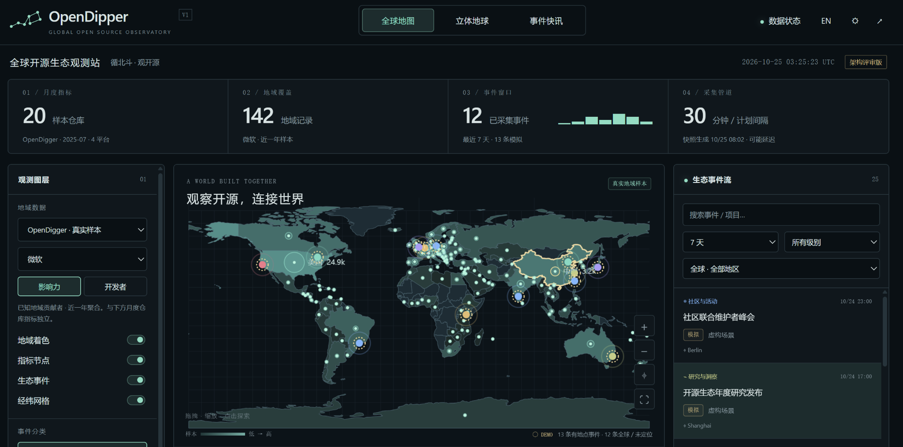
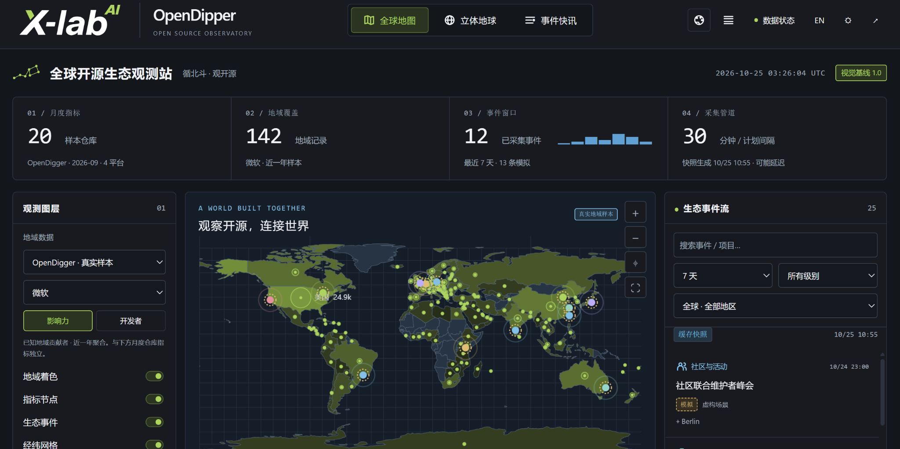
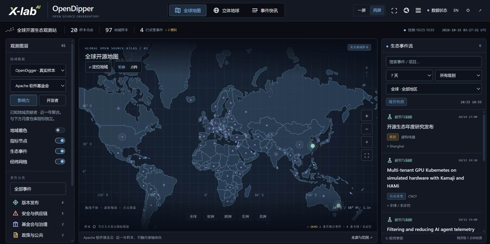
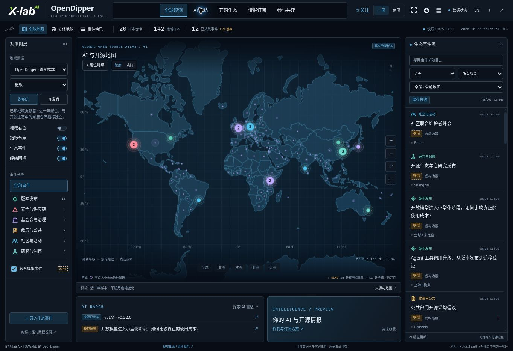
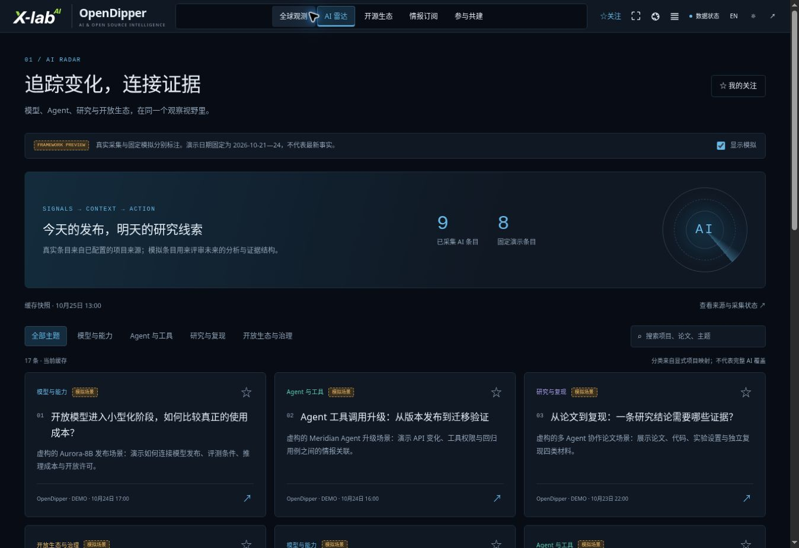

# Visual evolution · 2026-10-25

Three screenshots supplied by the maintainer record the progression from the architecture review to brand integration and the compact map presentation. They complement the [milestone history](../HISTORY.md); the current design rules remain in the [visual baseline](../VISUAL_SYSTEM.md).

These are historical interface snapshots, not live statistics or a claim that every displayed event is observed. Sample counts, selected organizations, observation periods and demo events differ between captures and should not be compared as a time series. The stage labels describe visible interface characteristics; the attachments do not identify their exact source commit.

## 1. Architecture review

The map / globe / wire structure is already present, with four large summary cards above the map and side panels for layers and events. The interface uses a teal palette and an independent OpenDipper wordmark. This image preserves the starting point for the later brand and layout work.

## 2. X-lab brand integration

The X-lab AI logo and brand green enter the interface, while the large header and summary cards remain. The next iteration reduced the logo footprint, separated brand color from data semantics and reclaimed map space. This is a process record, not the current visual specification.

## 3. Compact map presentation

The smaller logo, slim summary strip and restrained blue palette give the map more room. Region navigation, outline / point views and one-screen / two-screen controls are visible. The captured view has **two-screen mode selected**; the application default remains one-screen mode. This image was used by both README editions before the intelligence portal update; it is retained here as history. It shows the map, not a complete tour of the globe or analysis views.

## Source and maintenance

Received on **2026-10-25 (Asia/Shanghai)**. The image headers display UTC. All three PNGs are preserved byte-for-byte, without cropping, recoloring or rewriting their labels. Documentation and captions were organized with AI assistance from the maintainer's supplied images.

| Supplied filename | Repository asset | Dimensions |
| --- | --- | --- |
| `image(20261025-032551).png` | [Architecture review](../assets/evolution/2026-10-25-01-architecture-review.png) | 2048 × 1014 |
| `image(20261025-032626).png` | [Brand integration](../assets/evolution/2026-10-25-02-brand-baseline.png) | 2048 × 1023 |
| `image(20261025-032815).png` | [Map showcase](../assets/open-dipper-map-2026-10-25.png) | 2048 × 1023 |

Keep these dated originals as curated history. When replacing the homepage showcase, add a new dated asset and update both README editions together; retain this record and its original images. Automatically generated browser QA screenshots remain ignored build artifacts. Brand and source notices still apply; see [rights status](../RIGHTS.md).

## 4. AI and open-source intelligence portal

The 1.1.0 portal keeps the accepted map/globe/wire and adds AI radar, ecosystem analysis, browser-local following, a public sample brief and contribution tasks. This new capture is from the production site on 2026-10-25, after [implementation 4a989df](https://github.com/X-lab2017/open-dipper/commit/4a989dfa91924abb857ea0b6c9ea97ec130a3d06) passed [CI and deployment](https://github.com/X-lab2017/open-dipper/actions/runs/40163939827). It is an AI-assisted browser capture, not one of the three maintainer-supplied originals. Both README editions now use this dated portal capture. Fixed demo content and subscription proposals remain visibly labelled. The original three assets above are unchanged.

The radar capture is from the same production release and date; it shows the first screen, not the complete feed. Counts and cache timestamps describe that capture only.
