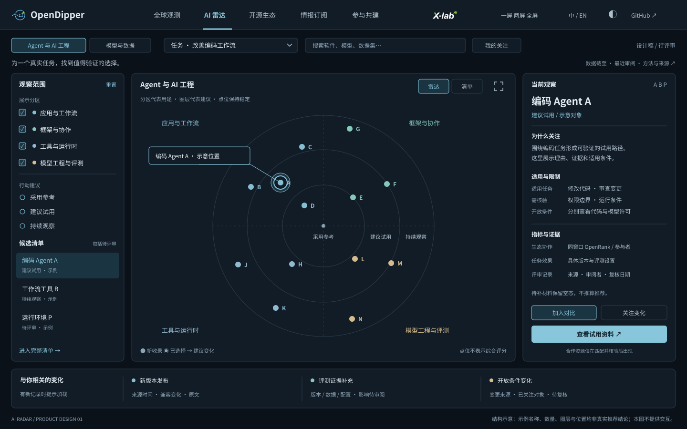

# AI 雷达：发现变化，辅助选型

**状态：方案待评审，尚未实现。** 日期：2026-10-26；[评审 issue #26](https://github.com/X-lab2017/open-dipper/issues/26)。本文不改变当前 `#radar` 页面、线上数据、订阅服务或推荐结论。当前运行事实见 [INTELLIGENCE.md](../INTELLIGENCE.md)。视觉复用 [Atlas 1.3.0 基线](../../design/baselines/atlas-1.3.0.md)，设计按 [模块模板](../templates/OBSERVATORY_MODULE.md) 组织。

English summary: a proposed task-oriented AI radar with two lenses—Agent & AI engineering, and Models & data. Source observations, editorial judgments and changes remain separate. Public discovery supports optional future personal intelligence services. Maintainer review precedes frontend implementation.

## 1. 用户得到什么

帮助用户回答：**为我的任务应该关注什么、值得试什么、最近发生了什么变化、判断依据是什么？** 雷达图负责建立全貌，清单与详情负责完成选择，持续关注负责让用户回来。

首期聚焦开发者和研究者；企业技术负责人可以复用同一套选型流程。政策、地域和基金会的宏观观察继续由全球观测承担，不在这里再复制一块大屏。

| 首期任务入口 | 用户问题 | 应带走的结果 |
| --- | --- | --- |
| 改善编码工作流 | 哪些编码 Agent、工具和模型值得试？ | 2–3 个有理由的候选，以及试用步骤 |
| 构建知识 / 研究 Agent | 框架、检索、工具、评测如何搭配？ | 一份分角色的候选清单，已核验的兼容关系 |
| 选择本地模型与评测数据 | 哪个具体版本适合我的任务与资源？ | 模型版本对比、部署资料、可用评测数据入口 |

不先要求用户识别复杂技术分类。任务切换产生推荐筛选条件，允许修改；高级筛选只有在字段覆盖足够、证据可用时开放。未取得显存/成本证据，不能显示“可在你的设备运行”。

## 2. 产品结构：两个入口，一个决策流程

顶栏保留“全球观测 / AI 雷达 / 开源生态 / 情报订阅 / 参与共建”。AI 雷达内设置两个视角，共享搜索、任务、关注、对比与证据模型。

| 视角 | 四个展示分区 | 纳入对象与边界 |
| --- | --- | --- |
| **Agent 与 AI 工程** | 应用与工作流；框架与协作；工具与运行时；模型工程与评测 | 软件项目，包括 Agent Infra 和 Model Infra 的软件工具；推理引擎、训练框架、数据处理工具不冒充模型或数据集 |
| **模型与数据** | 语言与推理；多模态与具身；检索与表示；数据与评测集 | 具体模型版本、具体数据集版本；编码是任务标签，不另造一套重复模型目录 |

一个实体在当前视角只设一个主分区，其余能力用多标签表示。分区是发现入口，不是严格行业标准；保留上游原分类和映射版本。切换视角保留用户任务；不跨软件、模型、数据集计算总分或混排性能。

软件侧上游分类映射建议：应用入口/编码/工作流/聊天工作区 → 应用与工作流；代码框架/多 Agent 编排 → 框架与协作；工具调用/协议/沙箱/记忆 → 工具与运行时；数据工程/训练/推理/部署/调度/网关/可观测评测 → 模型工程与评测。跨界项目由编辑确定主类并记录理由。

模型侧保留报告六任务域：Text Generation → 语言与推理；Image & Video、Speech & Audio、Multimodal、Robotics → 多模态与具身；Embeddings & Retrieval → 检索与表示。数据集补录进入数据与评测集，再按训练、微调、评测、语料等用途筛选。评测软件和评测数据是不同实体。

## 3. 雷达表达什么

借鉴 Thoughtworks 的“分类 + 行动建议 + 变化说明”，以及 Zalando 的可配置 SVG/D3、点位避让和清单联动。Thoughtworks 当前是 Adopt / Trial / Assess / Caution 四圈；它依赖其自身实践与编辑评审，不能直接移植结论。本方案初期采用**三圈 + 独立风险状态**，减少误读：

| 由内向外 | 产品含义 | 发布门槛 |
| --- | --- | --- |
| **采用参考** | 在明确场景下，有可参考的采用经验 | 具体版本、可核验案例/复现、关键限制、人工审阅和复核日期齐备 |
| **建议试用** | 值得做一个可验证的小试验 | 可执行试用资料、任务适配理由、版本及限制已审阅；不等于生产验证 |
| **持续观察** | 值得跟踪，但证据或成熟度仍有限 | 至少有已核查的一手来源与关注理由 |

**待评审不占任何一圈**：只进入候选清单，显示现有事实和待补材料；没有评审能力时宁可不填内圈。已知重大风险使用单独提示并说明证据，必要时撤下原建议；“未审阅”和“不建议使用”不能混为一谈。建议属于“实体版本 × 使用场景 × 评审版本”，不对项目作永久评级。

视觉规则：四个分区用克制的青蓝、青绿、灰蓝和沙金；圈层靠位置与文字表达；圆点等大，不再把热度叠到面积上。软件、模型、数据分视角与分区阅读，不改成方块、菱形。选中态使用统一高亮描边。“新收录 / 建议变化 / 重要更新”用小标记和文字；精确角度与圈内距离没有分数含义。

位置在同一版本内稳定；筛选只隐藏不相关点，不随机重排。对比历史只在同一场景、相同评审规则下显示迁移；无法比较时展示原因。订阅、赞助和资源合作不影响入圈或位置。

## 4. 一屏布局和交互

以上为**结构示意，点名、数量和位置均非推荐结果**。另见 [浅色示意](ai-radar-light.svg)和[模型与数据视角](ai-radar-models.svg)。三张图是原创静态 SVG，不是已实现交互页面。

- **顶部紧凑任务栏**：两个视角、任务选择、搜索、关注入口。证据日期与方法集中一处；不重复全球总量和多排标题。
- **左侧约 220–240px**：任务说明、分区筛选、建议层级、候选清单。缺少评审的候选仍可检索；默认关闭未经核验的商业筛选条件。
- **中间弹性主画布**：雷达 / 清单切换，默认只显示 12–16 个相关已审阅条目；更多条目通过清单获取，不堆几百个点。选中后联动右栏；键盘与触屏可以完成同样操作。
- **右侧约 300–340px**：一个对象的“为什么关注 / 适合与限制 / 指标与证据 / 下一步”。点击过的对象可保留轻量标签；跨类对象不能被当成同类性能排行。
- **底部 72–96px**：与当前任务或关注对象相关的变化带。显示真实发布时间和影响解释；有新记录时提示“新增 N 条”，用户决定加载，避免浏览中突然重排。来源未更新时保留原日期，不模拟真实增长。
- **对比抽屉**：最多 3 个同类候选。软件比协作和运行方式；模型比同任务/同配置评测、开放材料与部署条件；数据集比用途、版本、规模口径和复用条件。缺失显示“暂无可比证据”。跨类可以组成方案清单，不能成为综合排行榜。

默认进入 Agent 与 AI 工程 / 改善编码工作流；先展示已审阅证据最完整的候选，不默认“全选”。无满足条件条目时显示候选清单和待补证据，不能静默回退到演示。手机默认清单 + 详情抽屉；大屏一屏用于发现，两屏第二屏展示对比、变化与证据。保留全屏返回、Esc、语言、深浅主题、暂停动态与减少动态设置。

视觉沿用现有蓝灰背景、青蓝焦点、薄边框、稳定数字和紧凑排版。可以有一次低亮度入场扫光与更新点轻脉冲，但扫光不表示采集进度；不持续旋转雷达、不自动跳选对象。日期、结论、主要操作优先于装饰效果。

## 5. 已有数据能做什么

以下是 **2026-10-26 查阅的上游证据**，并非本网站已经接入的数据。固定来源见第 10 节。

| 来源 | 已核实可用内容 | 首期用途 | 不能直接推出 |
| --- | --- | --- | --- |
| Agentic AI Landscape | CSV 共 279 条记录；`keep/add` 145 条，含 Agent Infra 86、Model Infra 59；另有 `remove/omit`，不能全部当精选。含 repo_id、分类、许可字段、OpenRank、参与者、入选理由与局限 | 软件候选池、分类映射、同窗口生态趋势、选择线索 | 所有项目均符合开源资格；软件质量；生产成熟度；许可证商业适用结论 |
| GOSD 4.1 | 独立报告样本与技术方向、OpenRank 时间序列 | 领域变化的解释与背景图 | 与 Landscape 当前 CSV 混为同一分母；拿年度累计比较单月值 |
| GOSD 4.2 | 2026-10-02 快照，六任务领域各 16 条近 30 天下载记录，共 96 条 | 模型候选和任务分组；下载趋势入口需后续快照支持 | 下载等于用户数、任务能力或 ModelRank；单次快照构成增长曲线 |
| GOSD 5.1 | 模型/数据供给、发布账号、地域和独立窗口的历史序列 | 简短供给背景、发布者档案、资产关联 | 组织配套数据集统计等于完整数据集目录，或等于独立数据发布者全貌 |
| GOSD 5.2 | 模型派生关系、ModelRank 与月度榜单 | 版本谱系小图、生态衍生力和榜单变化 | 模型性能，或声明的派生关系等于已独立验证训练过程 |
| GOSD 5.3 | 材料完整性与许可开放性分开的样本、版本案例 | 有匹配依据时展示原评估与日期 | 对全体模型补齐评估；把完整性、开放性、影响力合为总分 |
| 当前 OpenDipper | 月度样本、部分 AI 项目发布、固定演示资料、本机关注 | 复用数据加载、来源展示、关注与事件契约 | 已有广覆盖 AI 信息采集、云端订阅或自动研究服务 |

采集适配时需要特别处理：Landscape 有 39 条许可为空或 `NOASSERTION`；文字入选理由中的旧数值可能与月度字段不同。理由用于保留编辑背景，当前数字以带窗口的字段为准；不自动把旧文字改写成最新结论。许可缺失表示未确认，既不是“不开放”，也不是“允许所有用途”。

**需要补齐的最小数据**：数据集级别身份/版本/用途/来源；候选项目与模型的一手卡片和开放条件；场景试用/评测证据；已验证的软件—模型—数据关系；可执行复核节奏。数据集版块不能只放一个全球总量或发布组织榜来替代实体。

初期内容预算建议 **30 个候选：12 个软件、12 个模型版本、6 个数据集版本**，这是目标而非已完成数量。先按三种用户任务建立完整证据卡；不为凑数自动入圈。报告和外部生态库继续作为可扩展候选源。

## 6. 数据结构与判断规则

| 记录 | 最小字段与职责 |
| --- | --- |
| `Entity` | 稳定 ID、类型（software/model/dataset）、平台、上游 ID、名称、版本/commit、发布者、原分类、任务标签、代码/权重/数据各自许可与材料状态 |
| `Observation` | entityId、指标及单位、值或 null、起止期、来源快照、采集时间、覆盖范围；OpenRank、ModelRank、下载各自独立 |
| `Assessment` | entityVersionId、scenarioId、圈层或 pending、理由、适用/不适用条件、证据 ID、reviewer、reviewedAt、nextReviewAt、方法版本；待审稿不能产生公开圈层 |
| `Relationship` | 两端稳定版本 ID、关系类型、证据；supports/trained-on/evaluated-on/derived-from 不能只按名称猜测 |
| `Signal` | 发布/许可/评测/维护状态等变化、实体 ID、publishedAt/capturedAt、来源、审核状态、影响说明及其证据 |
| `RadarEdition` | 场景、分类映射版本、评审快照、稳定位置、上版差异、发布时间；用于链接和回溯 |

模型家族用于聚合浏览，结论绑定版本；仓库重命名保留平台稳定 ID；量化或微调版本与基座显式关联。数据集的训练/测试拆分、版本和量级单位保留，不把行数、token 数、文件数互相比较。

排序仅在同类型、同指标、同窗口下发生；缺失值放末位并标明，不补零。环比必须有相邻完整窗口，基期为零或未知时不显示百分比爆发。任务评测还需相同数据集、设置和指标；没有这些条件就不输出“更强”。首期不建设一个加权 AI 总分。

## 7. 人和 Agent 如何共建

拟议流程：**候选采集 → 身份去重与字段校验 → 来源事实卡 → Agent 起草关注理由 → 维护者/领域贡献者审阅 → 固定版本发布 → 纠错与复核**。收录事实、推荐结论、事件发布的审核状态分别记录。

来源发布信号以 1–6 小时检查为未来目标，月度生态指标随上游，报告数据保持固定快照；推荐按月复核并可被重要变化触发。以上是设计目标，不是现有 SLA。展示“数据截至 / 最近采集 / 最近审阅”各自含义，不用当天日期替代它们。

发现未审阅更新时，可立即展示带来源的事实及“影响待审阅”；不得让 Agent 自动把点移动到“采用参考”。许可证重大变化、撤回或过期评审需触发重新审阅，保留历史，不继续伪装成最新建议。采集失败保留最后成功快照与过期状态。

研究者可以提交实体卡、复现实验、分类纠错和评审意见；只在实际完成审阅后展示署名，机构名称/标志需要真实授权。已有 #15 来源、#16 证据、#18 审阅、#19 首批材料继续承担相应工作，不重复创建平行任务。

## 8. 可持续性与业务闭环

| 层次 | 用户价值 | 产品边界 |
| --- | --- | --- |
| 公共入口 | 雷达发现、来源、基础趋势、对比、方法与纠错 | 公共资金与研究共建支持可信基础；不能通过付费隐藏必要来源或风险 |
| 个人高级情报（后续） | 关注对象的去重变更提醒、场景周报、可保存对比、版本影响与迁移提示 | 售卖节省判断时间的持续服务；待交付流程稳定后再验证价格和收费 |
| 试用与资源转化（后续） | 用户已经选定候选后，提供文档、仓库、模型卡或匹配的 OpenShare 资源入口 | 合作链接明确标识；有真实资源映射才出现，不虚构一键试用或当前权益 |
| 团队服务（后续验证） | 团队候选库、采用记录、私有清单和定向研究 | 先验证真实需求，不在首版承诺企业 API、采购或 SLA |

核心路径：公开发现 → 形成候选 → 完成比较/试用 → 关注变化 → 持续情报服务。商业合作独立于评审；禁止付费买位置和隐形推广。首版可以保留现有情报订阅介绍入口，不新增支付墙。

验收价值优先看：目标用户能否在几分钟内找到 2–3 个候选、解释选择依据并定位下一步；哪些证据缺口阻碍决定；关注后的更新是否确有用。后续再衡量回访、试用与订阅，避免只追求访问量或点数。

## 9. 实现拆分与评审门槛

**本轮只提交设计和基线。** 评审通过后再写实现计划与前端代码：

1. **第一版：可信发现。** 两个视角、三种任务、雷达/清单、单对象详情、候选/pending 状态；30 个候选目标和少量人工审阅；复用本机关注。缺失字段显示真实空态。
2. **第二版：完成选择。** 最多三对象同类对比、方案清单、可引用评审版本、真实变化记录与轻量谱系。上线前至少完成一个“发现 → 对比 → 试用入口 → 关注”完整流程。
3. **第三版：持续服务。** 扩充来源与评审协作，验证个人情报样刊；有账号、投递、服务端权益和实际用户需求后再做收费与团队服务。

实现可延用当前 Vite/TypeScript 和静态快照。新增雷达视图、统一实体适配和评审快照；复用 portal 的路由、来源和关注。不必为第一版引入 Next.js、图数据库或后台付费体系。Zalando 作为可借鉴的 MIT 实现，如果导入源码，应固定版本并保留完整版权/许可；本轮没有导入代码或产品图。

上线验收包括：两种主题、两种视角、三种任务；键盘/触屏同等信息；筛选不误改位置；pending 不入圈；无证据不生成关系/推荐；不跨窗口算增长；未知许可与过期评审清晰；无新数据时不制造脉冲；全屏可靠返回；小屏可完成同一任务。内容和功能上线须重新验证，不能沿用本轮文档检查。

本轮请优先评审：**两个视角是否合适；三种用户任务是否准确；三圈与证据门槛是否符合你希望建立的公信力。** 默认范围、内容预算和实施顺序均可据此收敛。

## 10. 来源、复用与设计记录

查阅日期 2026-10-26；链接为原资料，本文分类、圈层、页面和商业方案是 OpenDipper 的设计建议，不是来源方背书。

- [Thoughtworks Technology Radar](https://www.thoughtworks.com/radar) / [FAQ](https://www.thoughtworks.com/radar/faq)：分类、建议圈层、实践评审和版本变化。
- [Zalando tech-radar README](https://github.com/zalando/tech-radar/blob/master/README.md)：可配置的 SVG/D3 雷达与 MIT 声明；本轮仅设计参考。
- [Agentic AI Landscape 固定 CSV](https://github.com/antgroup/agentic-ai-landscape/blob/e330d75ea4ca314bc81f6868df63425c8acca5e3/data/agentic-ai-projects.csv)，blob `681604011cda10506a66419e03d36261dd0e909e`。数量为逐行解析结果，筛选 `landscape_action in {keep, add}`。该提交根目录未发现覆盖全仓的 LICENSE；未来复制/再分发数据前需维护者核对可用条款。本轮未复制其数据或图件入库。
- GOSD 固定提交 [c51e344](https://github.com/X-lab2017/2026-Global-Open-Source-Development-Report/tree/c51e3441361407b68f10b339d97eff288319b503)：[4.1 Agentic AI](https://github.com/X-lab2017/2026-Global-Open-Source-Development-Report/tree/c51e3441361407b68f10b339d97eff288319b503/chapters/chapter4)、[模型候选 CSV](https://github.com/X-lab2017/2026-Global-Open-Source-Development-Report/blob/c51e3441361407b68f10b339d97eff288319b503/data/processed/chapter4/fig-4-2-1_model_landscape_recent_downloads.csv)、[第五章说明](https://github.com/X-lab2017/2026-Global-Open-Source-Development-Report/tree/c51e3441361407b68f10b339d97eff288319b503/chapters/chapter5)。来源 X-lab2017 / GOSD；本页为摘要与设计映射，保留原统计范围和窗口。
- 原网页入口：[第四章](https://www.x-lab.info/2026-Global-Open-Source-Development-Report/2026/zh/chapters/04/#ch04-s01)、[第五章](https://www.x-lab.info/2026-Global-Open-Source-Development-Report/2026/zh/chapters/05/)。网页内容较大，本次通过相应仓库的固定文本/CSV 核对，未将不可读取页面当作验证成功。

AI 辅助披露：Codex 完成公开资料核对、CSV 结构统计、设计提案、原创 SVG 和基线/模板整理；维护者尚未审阅本雷达方案。没有进行了项目试用、模型测评或用户访谈的声明；示意图不含真实推荐结论。检查记录见[本轮交付计划](../plans/ai-radar-design.md)。
